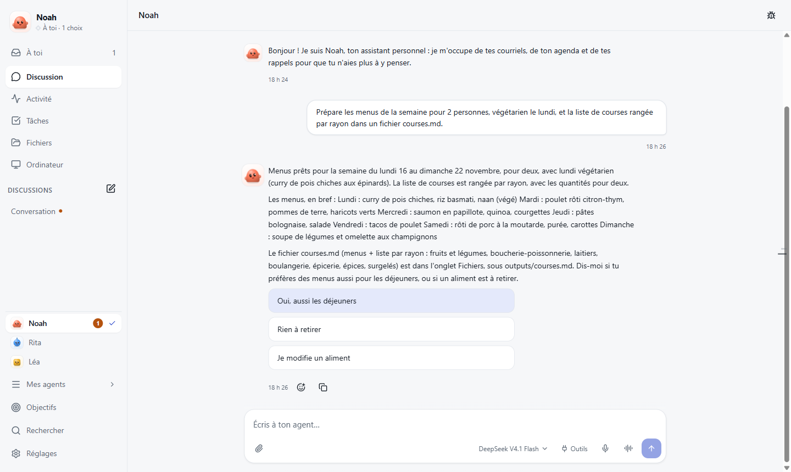
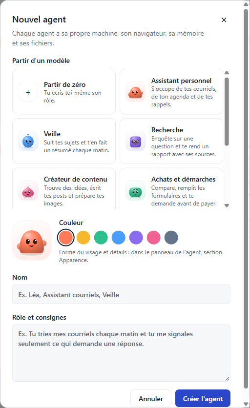
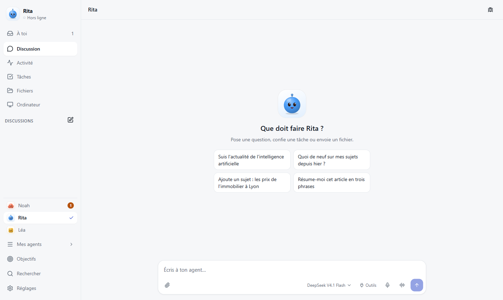
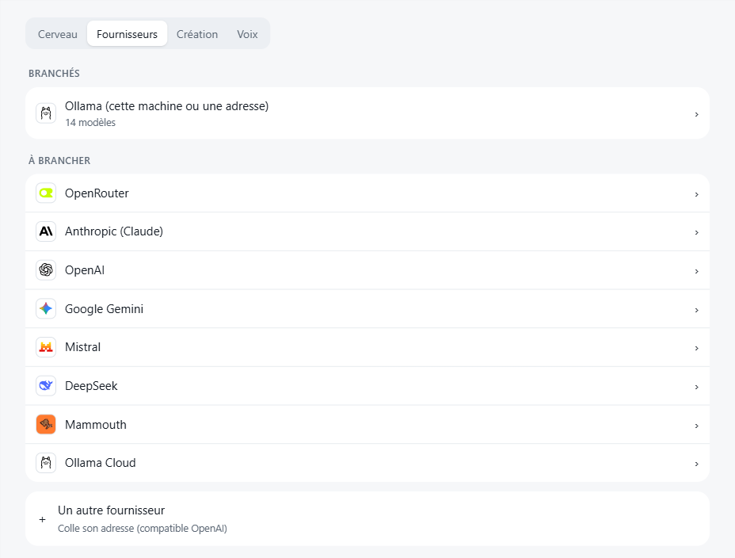
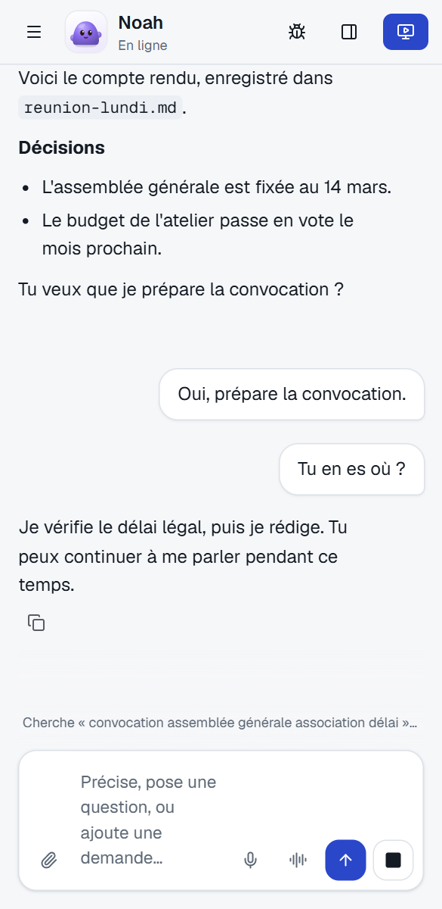
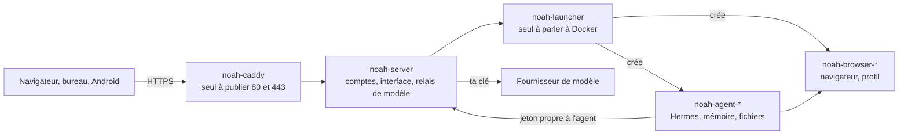

<p align="center"><a href="README.md">English</a> · <b>Français</b></p>

<p align="center">
  
</p>

<h1 align="center">Noah Agent</h1>

<p align="center">
  <strong>Des agents IA qui font tes tâches de tous les jours, sur ton propre serveur.</strong><br>
  Tu leur écris de l'ordinateur ou du téléphone ; ils naviguent, écrivent, surveillent et te préviennent.<br>
  Tes conversations restent chez toi. Le modèle, c'est toi qui le choisis.
</p>

<p align="center">
  <a href="https://github.com/smfcoder17/noah-agent/releases/latest"></a>
  
  
  <a href="LICENSE"></a>
</p>

<p align="center">
  <a href="#installer-en-une-phrase">Installer</a> ·
  <a href="#ce-que-tes-agents-font">Fonctions</a> ·
  <a href="#relier-ton-ordinateur-et-ton-téléphone">Appareils</a> ·
  <a href="#sécurité">Sécurité</a> ·
  <a href="docs/installation.md">Guide complet</a>
</p>

<p align="center">
  
</p>

## Installer en une phrase

Tu as un agent de code (Claude Code, Codex, Cursor…) ? Colle-lui ceci :

```text
Installe Noah Agent sur mon VPS en suivant https://github.com/smfcoder17/noah-agent/blob/main/AGENTS.md
```

Il te demande comment joindre ton serveur et si tu as un sous-domaine, installe la dernière version publiée, vérifie, puis te donne le lien pour créer ton compte. Tes mots de passe et tes clés, tu les saisis toi-même dans ton navigateur : l'agent n'en a pas besoin.

## Installer toi-même

**Il te faut** un VPS Ubuntu ou Debian (processeur x86_64 ou ARM64), 4 Go de mémoire (8 Go si plusieurs agents naviguent), 10 Go libres, et les ports 80 et 443 libres.

**1. Ouvre un terminal sur ton serveur** (SSH, ou la console web de ton hébergeur, connecté en root) et colle cette commande. Elle installe Docker s'il manque et place Noah dans `/opt/noah`, sans rien compiler.

```sh
curl -fsSL https://raw.githubusercontent.com/smfcoder17/noah-agent/main/get.sh | sh
```

**2. Ouvre le lien affiché à la fin**, de la forme `https://<ton-adresse>/#installation=…`. Si le navigateur signale une erreur de sécurité, attends une minute et recharge : le certificat se prépare. Le lien ne sert qu'une fois.

**3. Choisis « Nouvelle installation », crée ton compte, puis choisis ton modèle et colle sa clé.** Pas de clé ? [Ollama Cloud](https://ollama.com/settings/keys) est le plus simple. Puis crée ton premier agent à partir d'un modèle prêt à l'emploi.

Compte une dizaine de minutes, téléchargement compris.

**Ta propre adresse**, comme `noah.exemple.com` ? Crée d'abord chez ton fournisseur de domaine un enregistrement A de ce nom vers l'IP du serveur, puis lance plutôt :

```sh
curl -fsSL https://raw.githubusercontent.com/smfcoder17/noah-agent/main/get.sh | NOAH_DOMAIN=noah.exemple.com sh
```

Sans domaine, l'adresse est `<ip-en-tirets>.sslip.io` : elle marche, mais ton IP s'y lit.

| Autre cas | Fais ceci |
|---|---|
| Hostinger, sans terminal | Docker Manager > Compose > « Compose from URL », [ce fichier](https://github.com/smfcoder17/noah-agent/releases/latest/download/docker-compose.yml), nom de projet `noah`, puis Deploy. Le lien de création du compte est dans ⋮ > View logs. [Pas à pas](docs/installation.md#hostinger-docker-manager) |
| Un Traefik tient déjà les ports 80 et 443 | La même commande se range derrière lui ; relie-le ensuite avec `docker network connect noah-net <nom-du-traefik>`. [Détails](docs/installation.md#derrière-un-traefik) |
| Essayer sur ton ordinateur, sans serveur | Installe Docker Desktop, puis (sous Windows, dans Git Bash) `git clone https://github.com/smfcoder17/noah-agent.git`, `cd noah-agent`, `sh install.sh`, et ouvre http://localhost:8080 |

<details>
<summary><b>Ça bloque ?</b></summary>

| Ce que tu vois | Ce qu'il faut faire |
|---|---|
| « Le port 80 est déjà pris par … » | Un autre service tient ce port. Arrête-le, ou installe Noah sur un autre serveur. Un Traefik est reconnu tout seul |
| Le certificat HTTPS est refusé | Ton nom ne pointe pas encore vers le serveur (`getent hosts noah.exemple.com`), ou les ports 80 et 443 sont fermés dans le pare-feu de l'hébergeur |
| Plus de lien à la fin | Le compte existe déjà : ouvre l'adresse et connecte-toi |

Retrouver le lien de création du compte :

```sh
docker logs noah-server 2>&1 | grep installation=
```

Le reste : [En cas de souci](docs/installation.md#en-cas-de-souci).
</details>

Noah se met ensuite à jour seul, à l'heure calme, avec une sauvegarde avant et un retour arrière en cas de panne.

## Ce que tes agents font

<table>
<tr>
<td width="50%" valign="top">
<br>
<b>Prêts dès la création.</b> Neuf modèles d'agent : assistant personnel, veille, recherche, créateur de contenu, achats et démarches, finances du foyer, voyages et sorties, coach d'apprentissage, bricoleur d'apps. Tu pars de l'un d'eux et tu ajoutes ce que tu veux.
</td>
<td width="50%" valign="top">
<br>
<b>Tu sais quoi leur demander.</b> Chaque nouvel agent propose des demandes à toucher, adaptées à son rôle. Tu peux aussi lui écrire pendant qu'il travaille : il répond « Noté » et en tient compte.
</td>
</tr>
<tr>
<td valign="top">
<br>
<b>Le modèle que tu veux.</b> Ollama (local ou Cloud), Mammouth, OpenRouter, Anthropic, OpenAI, Gemini, Mistral, DeepSeek, ou tout service compatible OpenAI. Un petit modèle rapide peut tenir la conversation, et un plafond arrête la dépense.
</td>
<td valign="top">
<br>
<b>Partout.</b> Navigateur, application Windows, application Android, et iPhone par l'écran d'accueil. Ils te préviennent : fin de tâche, veille en panne, crédit OpenRouter qui baisse, et un appel sur Android si tu l'autorises.
</td>
</tr>
</table>

- **Un ordinateur chacun.** Chaque agent a sa machine, sa mémoire, ses fichiers et son navigateur. Une connexion ou un CAPTCHA t'appartient ? Il t'appelle et tu prends la main sur son écran.
- **Tes outils.** Google (courriel, agenda, Drive, contacts, avec ton propre projet Google Cloud), Instagram, X et tout outil MCP. Pour Instagram, X et MCP, tu choisis : lire, demander confirmation, ou agir.
- **De lui-même.** Tâches à heure fixe, surveillance d'une source, objectifs qu'il garde en tête, et trois modes d'autonomie quand le juge est actif : Prudent, Auto (par défaut), Agir.
- **En équipe.** « Demande à Rita de préparer le compte rendu, et rappelle-moi quand c'est fini. » Un profil par personne, et le partage d'un agent avec des droits.
- **Il ne peut pas dire « c'est fait » sans que ça se voie.** Sous chaque réponse, un reçu compare ce qu'il affirme à ce que ses outils ont vraiment fait.

Noah est construit sur [Hermes Agent](https://github.com/NousResearch/hermes-agent) (MIT). Il y ajoute plusieurs agents isolés, un navigateur par agent, les applications, et les mises à jour avec retour arrière.

## Relier ton ordinateur et ton téléphone

Les applications se relient à ton serveur Noah. Chaque appareil demande ton accord, avec un nombre à 3 chiffres à recopier : tu ne tapes jamais ton mot de passe dans l'application.

| Appareil | Télécharge | Pour le relier |
|---|---|---|
| **Windows** | [noah-agent-windows-setup.exe](https://github.com/smfcoder17/noah-agent/releases/latest/download/noah-agent-windows-setup.exe) (non signé : Windows peut avertir) | « Sur mon serveur », ton adresse, « Relier », puis « Autoriser cet appareil » dans le navigateur |
| **Android** 8 ou plus | [noah-agent-android.apk](https://github.com/smfcoder17/noah-agent/releases/latest/download/noah-agent-android.apk) | Sur l'ordinateur, Réglages > Appareils > « Relier un appareil », puis « Scanner le QR code » dans l'app |
| **iPhone, Mac, Linux** | Rien | Ouvre ton adresse ; sur iPhone, « Ajouter à l'écran d'accueil » |

## Sécurité

Un agent peut être trompé par une page ou un message piégé. Quatre gardes limitent ce qu'il peut faire ; aucune ne suffit seule.

| Garde | Ce qu'elle fait | Sa limite |
|---|---|---|
| **Machine isolée** | Un conteneur et un navigateur par agent, sans accès à Docker ni à ta clé de modèle | Un conteneur, pas une machine virtuelle |
| **Accords** | Une carte montre l'action ; tu l'autorises ou la refuses | Un outil réglé sur « agir », ou le mode Agir, passe sans carte |
| **Juge** | Un second modèle relit l'action avant qu'elle sorte, sans lire les pages qui ont pu tromper l'agent | Un filtre, pas un bac à sable |
| **Coffre** | Tu saisis tes identifiants dans une carte ; le serveur les pose dans la page sans les donner à l'agent | Une fois connecté, l'agent agit avec la session ouverte |

Aucune télémétrie. Tes messages partent seulement chez le fournisseur de modèle que tu as choisi. Les conversations ne sont pas chiffrées sur le disque : qui a un accès root au serveur, ton hébergeur compris, peut les lire. Pas d'audit externe à ce jour. Détails et signalement d'une faille : [SECURITY.md](SECURITY.md).

## État

Noah est jeune. Il tourne en usage réel sur un VPS, et la plupart des parcours sont testés en local avec de vrais conteneurs et un vrai navigateur. Pas encore prouvés en conditions réelles : le parcours complet sur un VPS neuf, le QR code en 4G, l'appel vocal depuis le téléphone. Le détail : [docs/etat.md](docs/etat.md).

<details>
<summary><b>Noah face à Muse, Grok Bot et Dots</b></summary>

Muse (Meta), Grok Bot (xAI) et Dots (OpenAI) sont des services : un compte, et ils tournent chez leur éditeur. Noah tourne chez toi, et cela se paie en entretien.

| | Noah | Muse, Grok Bot, Dots |
|---|---|---|
| **Pour commencer** | Un VPS, une commande, un modèle | Un compte |
| **Conversations et mémoire** | Sur ton serveur | Chez l'éditeur |
| **Le modèle** | Celui que tu veux, local compris | Celui du service |
| **Le coût** | Le VPS, plus ta consommation | L'abonnement ou l'usage |
| **Si ça tombe en panne** | À toi de réparer | L'éditeur s'en occupe |
| **Si tu pars** | Ta sauvegarde va sur un autre serveur | Selon ce que le service exporte |

**Prends l'un d'eux** si tu veux que ça marche ce soir, sans serveur. **Prends Noah** si garder la main sur tes données et ton modèle vaut cet entretien. Relevé du 4 novembre 2026 : [docs/comportements.md](docs/comportements.md).
</details>

<details>
<summary><b>Architecture</b></summary>



Les agents et leurs navigateurs n'exposent aucun port. Le lanceur crée les conteneurs : il a l'équivalent d'un accès root, sans être exposé, et chaque appel exige sa clé ([le détail](docs/installation.md#le-socket-docker)). Les données vivent dans des volumes Docker et se [sauvegardent](docs/installation.md#sauvegarder) d'une commande.
</details>

<details>
<summary><b>Développer</b></summary>

```sh
sh install.sh                                # tout le projet, compilé en local
cd frontend && npm install && npm run dev    # l'interface à chaud, sur http://localhost:5173
node scripts/verifier.mjs                    # ce que la CI vérifierait
```

`server/` (API et comptes), `launcher/` (Docker), `frontend/` (l'interface), `desktop/` et `mobile/` (les applications), `deploy/` (ce qui part sur un VPS). Pour proposer un changement : [CONTRIBUTING.md](CONTRIBUTING.md).
</details>

## Licence

[PolyForm Noncommercial 1.0.0](LICENSE) : gratuit pour un usage personnel, une école, une association ou un organisme public. Un usage commercial demande un accord : ouvre un ticket. Les dépendances gardent leurs licences : [docs/licences.md](docs/licences.md).

## Liens

[Guide complet](docs/installation.md) · [Versions](https://github.com/smfcoder17/noah-agent/releases/latest) · [Feuille de route](docs/roadmap.md) · [État des preuves](docs/etat.md) · [Tickets](https://github.com/smfcoder17/noah-agent/issues) · [Contribuer](CONTRIBUTING.md) · [Sécurité](SECURITY.md)
