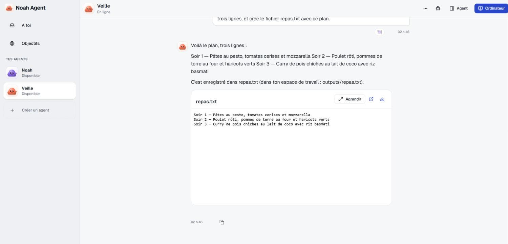
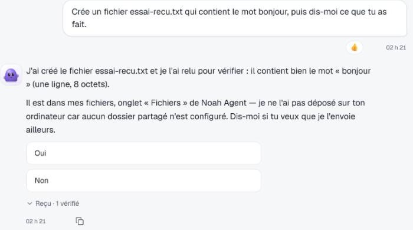
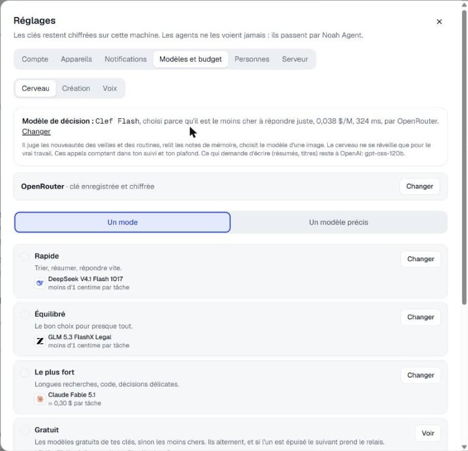
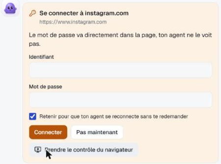
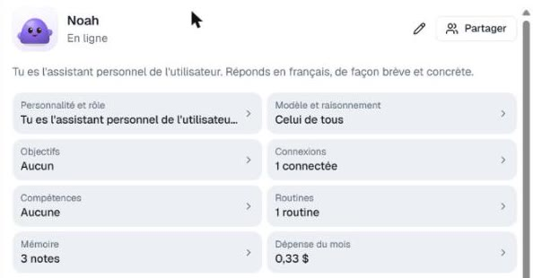
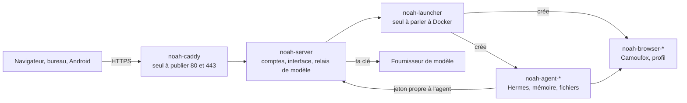

<p align="center">
  
</p>

<h1 align="center">Noah Agent</h1>

<p align="center">
  <strong>Des agents IA qui travaillent jour et nuit sur ton propre serveur, et que tu joins de l'ordinateur et du téléphone.</strong><br>
  Pour toi si tu veux tes agents sur ton propre serveur, sans confier tes conversations à un service. Code source disponible, interface en français. Il te faut un VPS, ou Docker sur ton ordinateur pour essayer.
</p>

<p align="center">
  <a href="LICENSE"></a>
  <a href="https://github.com/smfcoder17/noah-agent/releases/latest"></a>
  
  
</p>

<p align="center">
  <a href="#installer-sur-un-vps">Installer</a> ·
  <a href="#relier-le-bureau-et-le-téléphone">Relier tes appareils</a> ·
  <a href="#ce-que-tes-agents-savent-faire">Fonctions</a> ·
  <a href="#noah-face-à-muse-grok-bot-et-dots">Comparer</a> ·
  <a href="#sécurité">Sécurité</a> ·
  <a href="#état">État</a> ·
  <a href="docs/installation.md">Guide complet</a>
</p>

<p align="center">
  <br>
  <sub>Capture de la vraie interface, sur une installation locale, avec un vrai modèle.</sub>
</p>

> [!IMPORTANT]
> Noah est jeune. Le parcours complet n'a pas encore été suivi sur un VPS neuf ni sur un vrai téléphone : [ce qui est prouvé et ce qui ne l'est pas](#état).

## Installer sur un VPS

Pour un agent joignable partout. Pour essayer sans serveur, passe à [Installer sur ton ordinateur](#installer-sur-ton-ordinateur).

Il te faut un VPS Ubuntu ou Debian, 4 Go de mémoire au moins (plutôt 8 Go si plusieurs agents naviguent), 10 Go libres et les ports 80 et 443 libres. Choisis une voie : compte une dizaine de minutes, téléchargement compris. À la fin, un lien te permet de créer ton compte.

**Un clic chez Hostinger.** Le bouton mène à l'achat d'un VPS, avec Noah préchargé. Nomme le projet `noah`, exactement, puis Deploy. Ce bouton suit la [documentation de Hostinger](https://www.hostinger.com/support/deploy-on-hostinger-button/), mais nous ne l'avons pas encore essayé.

[](https://www.hostinger.com/docker-hosting?compose_url=https://github.com/smfcoder17/noah-agent/releases/latest/download/docker-compose.yml)

Tu as déjà un VPS chez eux ? Docker Manager > Compose > « Compose from URL », avec [l'adresse de ce fichier](https://github.com/smfcoder17/noah-agent/releases/latest/download/docker-compose.yml) et le même nom de projet.

**Une commande, chez n'importe quel hébergeur,** en root sur le serveur. [Le script](get.sh) installe Docker s'il manque et place Noah dans `/opt/noah`, sans rien compiler.

```sh
curl -fsSL https://raw.githubusercontent.com/smfcoder17/noah-agent/main/get.sh | NOAH_DOMAIN=noah.exemple.com sh
```

Avec un sous-domaine, crée d'abord un enregistrement A de ce nom vers l'IP du serveur, sinon le certificat HTTPS sera refusé. Sans sous-domaine, retire `NOAH_DOMAIN=noah.exemple.com` : Noah répond alors sur `<ip-en-tirets>.sslip.io`, et ton IP se lit dans l'adresse.

**Un agent de code** (Codex, Claude Code). Donne-lui l'adresse de ce dépôt et demande-lui de suivre [AGENTS.md](AGENTS.md).

**Ensuite, dans les trois cas :**

1. Ouvre le lien de création du compte. Il s'affiche à la fin de la commande, ou dans les journaux : View logs chez Hostinger, `docker logs noah-server 2>&1 | grep installation=` ailleurs. Il porte un code à usage unique.
2. Crée ton compte, choisis ton modèle et colle sa clé. Sans clé en main, Ollama Cloud est le plus simple sur un VPS : [crée une clé ici](https://ollama.com/settings/keys).
3. Crée ton premier agent et écris-lui.

Un Traefik tient déjà les ports 80 et 443 ? Lis [Derrière un Traefik](docs/installation.md#derrière-un-traefik). Pour choisir ton adresse : [Adresse et domaine](docs/installation.md#adresse-et-domaine).

## Installer sur ton ordinateur

Pour essayer sans serveur. Installe [Docker Desktop](https://docs.docker.com/get-docker/) et démarre-le, puis, sous Windows dans Git Bash :

```sh
git clone https://github.com/smfcoder17/noah-agent.git
cd noah-agent
sh install.sh
```

Ouvre http://localhost:8080. Tout se compile chez toi, et Noah n'est pas ouvert au réseau. Pour mettre à jour : `git pull && sh install.sh`.

## Relier le bureau et le téléphone

Les applications ne font rien sans un serveur Noah : elles s'y relient. Chaque appareil demande ton accord, avec un nombre à 3 chiffres à recopier, et tu ne tapes pas ton mot de passe dans l'application pour la relier.

| Appareil | À installer | Pour le relier |
|---|---|---|
| **Windows** | [noah-agent-windows-setup.exe](https://github.com/smfcoder17/noah-agent/releases/latest/download/noah-agent-windows-setup.exe), non signé : Windows peut afficher un avertissement | « Sur mon serveur », ton adresse en `https://`, « Relier ». Dans le navigateur, « Autoriser cet appareil », puis recopie le nombre dans l'application |
| **Android** 8 ou plus récent | [noah-agent-android.apk](https://github.com/smfcoder17/noah-agent/releases/latest/download/noah-agent-android.apk), hors Play Store | Sur l'ordinateur, Réglages > Appareils > « Relier un appareil ». Dans l'app, « Scanner le QR code ». Recopie le nombre sur l'ordinateur, puis « Autoriser » |
| **iPhone, Mac, Linux** | Rien : il n'y a pas encore d'app iPhone | Ouvre ton adresse HTTPS. Sur iPhone, « Ajouter à l'écran d'accueil » |

Pour les notifications sans service de Google, installe aussi l'app gratuite [ntfy](https://ntfy.sh). Détails : [Ton téléphone](docs/installation.md#ton-téléphone).

## Ce que tes agents savent faire

<table>
<tr>
<td width="28%"></td>
<td>

- **Travailler chacun chez lui.** Chaque agent a sa machine, sa mémoire, ses fichiers et son navigateur.
- **T'écouter pendant qu'ils travaillent.** À l'écrit, ou à la voix avec une clé OpenRouter ou ton propre serveur de voix.
- **Naviguer et te passer la main.** Une connexion ou un CAPTCHA t'appartient ? L'agent t'appelle, et tu prends la main sur son écran.
- **Se servir de tes outils.** Des outils externes (MCP), Google, la publication sur Instagram et X. Tu choisis le droit de chaque outil : lire, agir ou demander confirmation.
- **Se répartir le travail.** « Demande à Rita de préparer le compte rendu, et rappelle-moi quand c'est fini. »
- **Revenir vers toi.** Des tâches à heure fixe, la surveillance d'une source, des notifications, et un appel sur Android si tu l'autorises.
- **Partager.** Un profil par personne, et le partage d'un agent avec des droits.
- **S'entretenir.** Mises à jour seules à l'heure calme, signées, avec sauvegarde avant et retour arrière en cas de panne.

</td>
</tr>
</table>

Le modèle reste ton choix : Ollama, un serveur compatible OpenAI, OpenRouter, Anthropic, OpenAI ou Gemini. Tes dépenses du mois sont affichées et un plafond peut les arrêter. Ollama et les serveurs compatibles comptent 0 $ : le plafond ne les arrête donc pas.

### Il ne peut pas te dire que c'est fait sans que ça se voie

<p></p>

Sous chaque réponse, un reçu compare ce que l'agent affirme à ce que ses outils ont vraiment fait. Une affirmation sans trace, ou une action qu'il n'a pas mentionnée, se voit tout de suite. Il compare le type d'action, pas sa cible : c'est un signal, pas une preuve que tout est juste.

### Nouveau dans cette version

Essayé en local. Pas encore en usage sur la durée.

<table><tr><td width="56%"></td><td><br><br></td></tr></table>

- **Modes de modèles.** Rapide, Équilibré, Le plus fort, Gratuit et Custom, pour le cerveau, la création et la voix, par agent et par tâche. Gratuit et Custom sont des chaînes : si un modèle est épuisé ou en panne, le suivant prend le relais.
- **Objectifs.** Tu écris ce que tu veux atteindre. Tes agents le gardent en tête et peuvent te proposer une chose concrète, une fois par jour au plus.
- **Agent proactif.** Par agent : Coupé, Me signaler ou Agir et me dire, de 15 min à 6 h. Sans rien de neuf dans ses sources, il n'appelle aucun modèle. Testé par simulation, pas encore sur une vraie boîte de courriel.
- **Connexion sécurisée dans le chat.** L'agent demande à se connecter à un site, et tu saisis tes identifiants dans une carte de la conversation. Il ne les voit pas : voir [Coffre](#sécurité).
- **Il apprend de toi.** Une correction, une préférence, une réaction 👍 ou 👎 ou un accord refusé : l'agent le retient pour la prochaine fois, sans rien t'afficher de plus qu'un petit « retenu ».
- **Tout voir de ton agent.** Le menu à trois points et un résumé montrent sa personnalité, son modèle, ses connexions, ses compétences, ses routines, sa mémoire et sa dépense.
- **Connexions pour tous.** Une connexion vaut pour un agent ou pour tous, avec une case pour en exclure. Compétences : ce que tu lui enseignes, à part de ce qu'il apprend seul.
- **Vidéos dans le fil.** YouTube et d'autres se lisent dans la conversation, et un lien externe ouvre la vraie application.

## Noah face à Muse, Grok Bot et Dots

Muse (Meta), Grok Bot (xAI) et Dots (OpenAI) sont des services : tu crées un compte, et ils tournent chez leur éditeur. Noah tourne chez toi, et cela se paie en entretien.

<details>
<summary>Le tableau, point par point</summary>

| | Noah | Muse, Grok Bot, Dots |
|---|---|---|
| **Pour commencer** | Louer un VPS, déployer, choisir un modèle | Un compte |
| **Conversations et mémoire** | Sur ton serveur. Ton hébergeur peut les lire, et le fournisseur de modèle lit ce qu'il reçoit | Chez l'éditeur, selon ses conditions |
| **Le modèle** | Celui que tu veux, local compris | Celui que le service propose |
| **Le coût** | Le VPS, plus ta consommation du modèle | L'abonnement ou l'usage |
| **Prendre la main sur l'écran de l'agent** | Oui | Oui chez Dots. Étapes rendues à l'humain chez Grok Bot |
| **L'agent te fait sonner** | Oui sur Android, pas encore vérifié sur un vrai téléphone | Dots ne le fait pas à son lancement. Grok Bot et Muse reviennent par message ou notification |
| **La portée d'un accord** | Autoriser ou refuser, et un droit par outil. Rien par site ni par tâche | Plus fine : une fois, cette tâche, ce site ou toujours chez Muse |
| **Une longue tâche pendant un appel vocal** | Silence entre l'accusé et le résumé | Dots peut donner de lui-même l'étape en cours |
| **Si ça tombe en panne** | C'est ton serveur, à toi de réparer | L'éditeur s'en occupe |
| **Si tu pars** | Ta sauvegarde va sur un autre serveur | Selon ce que le service permet d'exporter |

</details>

**Prends l'un d'eux** si tu veux que ça marche ce soir, sans serveur à gérer. **Prends Noah** si garder la main sur tes données et ton modèle vaut cet entretien.

Ce tableau vient d'un [relevé du 4 novembre 2026](docs/comportements.md), fait sur leur documentation et sur des vidéos publiques, sans compte chez eux. Ce n'est pas un classement.

Noah est construit sur [Hermes Agent](https://github.com/NousResearch/hermes-agent), open source sous licence MIT. Il y ajoute plusieurs agents isolés, un navigateur par agent, des applications de bureau et Android, et des mises à jour avec retour arrière. Un seul agent dans ton terminal ou sur Telegram te suffit ? Hermes seul fera l'affaire.

## Sécurité

Un agent peut être trompé par une page ou un message piégé. Noah part de là : quatre gardes limitent ce qu'il peut faire, et aucune ne suffit seule.

| Garde | Ce qu'elle fait | Sa limite |
|---|---|---|
| **Machine isolée** | Chaque agent a son conteneur et son navigateur, sans accès à Docker ni à la clé du fournisseur | C'est un conteneur, pas une machine virtuelle |
| **Accords** | Une carte montre l'action, et tu l'autorises ou la refuses, même pendant un appel vocal | Arrête le modèle, pas toujours un agent déjà détourné. Le droit « agir » passe sans carte |
| **Juge** | Un second modèle vérifie l'action avant qu'elle sorte, sans lire les pages qui ont pu tromper l'agent | C'est un filtre, pas un bac à sable, et il consomme ton modèle |
| **Coffre** | Tu saisis tes identifiants dans une carte, et le serveur les pose dans la page sans les donner à l'agent | Une fois connecté, l'agent agit avec la session ouverte |

**Tes données.** Elles restent sur ton serveur. Noah n'a aucune télémétrie, et Réglages > Serveur > Confidentialité liste ce qui sort. Tes messages partent chez le fournisseur de modèle choisi, et tes conversations ne sont pas chiffrées sur le disque : qui a un accès root, ton hébergeur compris, peut les lire.

**Ton accès.** Pas d'inscription publique, un lien de création à usage unique, HTTPS, double vérification en option, et un accord pour chaque nouvel appareil.

Aucun audit externe n'a été fait. Le détail de chaque garde, ce qui sort du serveur et ce que Noah ne protège pas sont dans [SECURITY.md](SECURITY.md). C'est aussi là que tu signales une faille.

## État

Noah compte une preuve seulement si elle atteint le niveau exigé, en général les conditions réelles : VPS neuf, téléphone, 4G. Selon [docs/etat.md](docs/etat.md), **0 parcours sur 10 est tenu à ce niveau, et 1 objectif sur 17 atteint son seuil** : les mises à jour. Huit parcours sur dix tournent déjà en local, avec de vrais conteneurs ou un vrai navigateur. Deux n'y sont pas encore : la mise à jour majeure avec panne provoquée, et l'appel vocal depuis le téléphone.

Pas encore vérifié :

- le parcours complet sur un VPS neuf, le bouton Hostinger, le chemin derrière le Traefik de Hostinger ;
- le QR code en 4G et l'écran d'appel Android sur un vrai téléphone ;
- la voix en conditions réelles : délai de réponse, tâches avec outils, consommation ;
- la mesure sur 24 h de ce qui sort d'un vrai VPS, et le scan depuis Internet.

## Architecture



Les agents et leurs navigateurs n'exposent aucun port. Le lanceur crée les conteneurs : il a donc l'équivalent d'un accès root, sans être exposé, et chaque appel exige sa clé ([le détail](docs/installation.md#le-socket-docker)). Les données vivent dans des volumes Docker et se [sauvegardent](docs/installation.md#sauvegarder) d'une commande, pour être restaurées ici ou sur un autre serveur.

## Développement

```sh
sh install.sh                                # tout le projet, compilé en local
cd frontend && npm install && npm run dev    # l'interface à chaud, sur http://localhost:5173
node scripts/verifier.mjs                    # ce que la CI vérifierait
```

`server/` (API et comptes), `launcher/` (Docker), `frontend/` (l'interface), `desktop/` et `mobile/` (les applications), `deploy/` (ce qui part sur un VPS). Pour construire les applications et proposer un changement : [CONTRIBUTING.md](CONTRIBUTING.md).

## Licence

[PolyForm Noncommercial 1.0.0](LICENSE). Le code est public et gratuit pour un usage personnel non commercial, et pour une école, une association caritative ou un organisme public. Un usage commercial demande un accord à part : ouvre un ticket.

Tu peux lire le code, le modifier et l'installer, avec cette restriction. Cette licence n'est pas approuvée par l'OSI, puisqu'elle limite le commerce. Les dépendances gardent leurs licences : [docs/licences.md](docs/licences.md).

## Liens

- [Guide complet](docs/installation.md) : toutes les voies d'installation, la voix, les sauvegardes, les pannes
- [État des preuves](docs/etat.md) et [méthode d'évaluation](docs/evaluation.md)
- [Feuille de route](docs/roadmap.md) et [architecture détaillée](docs/architecture.html)
- [Versions et téléchargements](https://github.com/smfcoder17/noah-agent/releases/latest)
- [Tickets](https://github.com/smfcoder17/noah-agent/issues), [contribuer](CONTRIBUTING.md), [sécurité](SECURITY.md)
