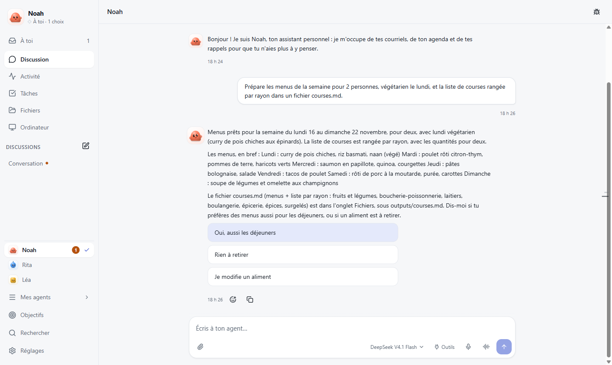
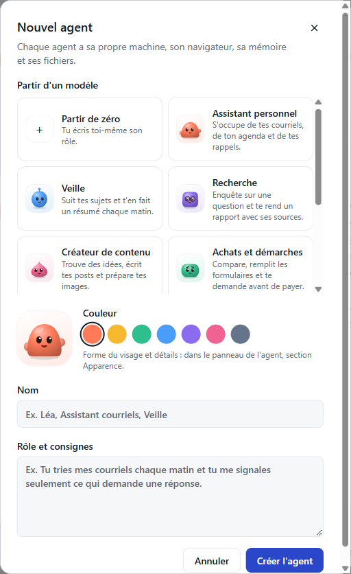
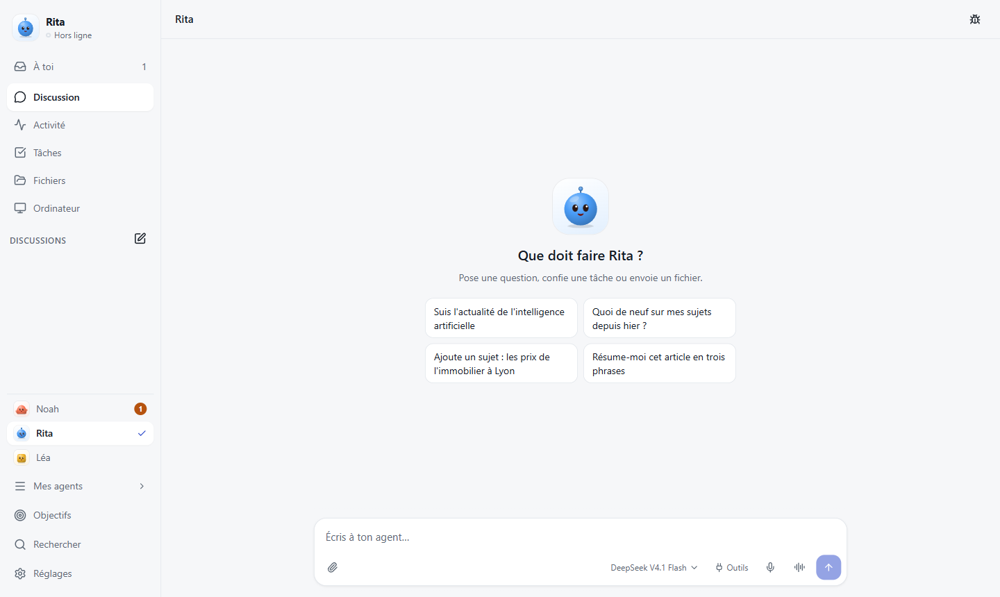
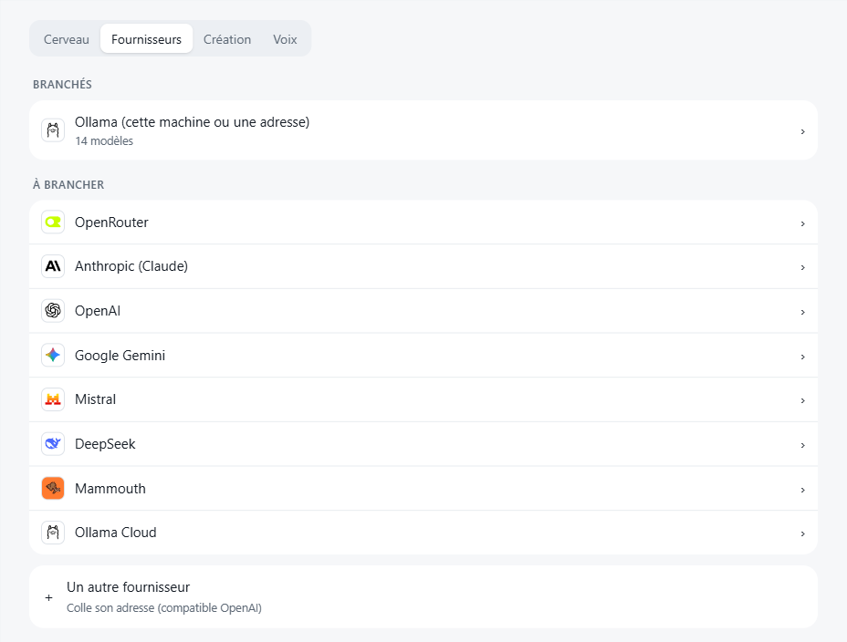
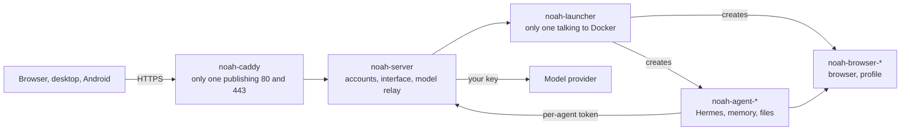

<p align="center"><b>English</b> · <a href="README.fr.md">Français</a></p>

<p align="center">
  
</p>

<h1 align="center">Noah Agent</h1>

<p align="center">
  <strong>AI agents that work for you. On your own server.</strong><br>
  Give each agent a job. It browses, writes, keeps watch and comes back when it's done.<br>
  Talk to it from your computer or your phone, and pick the model it runs on.
</p>

<p align="center">
  <a href="https://github.com/smfcoder17/noah-agent/releases/latest"></a>
  
  
  <a href="LICENSE"></a>
</p>

<p align="center">
  <a href="https://noah-agent.smfcoder.com">Website</a> ·
  <a href="#install">Install</a> ·
  <a href="#what-your-agents-do">Features</a> ·
  <a href="#apps">Apps</a> ·
  <a href="docs/installation.md">Full guide</a>
</p>

<p align="center">
  
</p>

## What it is

Noah is software you install on your own server or computer. Each agent gets its own computer: a browser, a memory and files. Your conversations stay on your machine, and you choose the model.

It is not a hosted service. There is no account with us, no subscription and no telemetry.

## Install

**You need** an Ubuntu or Debian server (a VPS, or your own Linux machine) with x86-64 or ARM64, 4 GB of RAM (8 GB if several agents browse at once), 10 GB free, and ports 80 and 443 open. Docker is installed for you if it's missing.

**1. Run one command** on the server, as root:

```sh
curl -fsSL https://raw.githubusercontent.com/smfcoder17/noah-agent/main/get.sh | sh
```

It installs Docker if needed and puts Noah in `/opt/noah`, without compiling anything.

**2. Create your account in the browser.** Open the link printed at the end, of the form `https://<your-address>/#installation=…`. If the browser shows a security error, wait a minute and reload: the certificate is being issued. The link works once. Choose « Nouvelle installation » (new installation), create your account, then pick your model and paste its key. No key yet? [Ollama Cloud](https://ollama.com/settings/keys) is the simplest. Then create your first agent from a template.

**3. Link your phone.** Install the [Android app](https://github.com/smfcoder17/noah-agent/releases/latest/download/noah-agent-android.apk). On your computer, open **Settings > Devices > Link a device** (in the app's French interface: Réglages > Appareils > « Relier un appareil »). A QR code appears. In the Android app, tap « Scanner le QR code » (scan the QR code), then confirm the three-digit number.

Allow about ten minutes, download included.

**Prefer to let a coding agent do it?** Paste this into Claude Code, Codex or Cursor:

```text
Install Noah Agent on my VPS by following https://github.com/smfcoder17/noah-agent/blob/main/AGENTS.md
```

It asks how to reach your server and whether you have a subdomain, installs the latest release, checks it, and gives you the link to create your account. You type your passwords and keys yourself, in your browser.

**Your own address**, like `noah.example.com`? First create an A record for that name pointing to the server's IP, then run:

```sh
curl -fsSL https://raw.githubusercontent.com/smfcoder17/noah-agent/main/get.sh | NOAH_DOMAIN=noah.example.com sh
```

Without a domain, the address is `<ip-with-dashes>.sslip.io`.

| Other case | Do this |
|---|---|
| Hostinger, no terminal | Docker Manager > Compose > « Compose from URL », [this file](https://github.com/smfcoder17/noah-agent/releases/latest/download/docker-compose.yml), project name `noah`, then Deploy. The account link is in ⋮ > View logs. [Step by step](docs/installation.md#hostinger-docker-manager) |
| Traefik already holds ports 80 and 443 | The same command sets Noah up behind it; then run `docker network connect noah-net <traefik-container>`. [Details](docs/installation.md#derrière-un-traefik) |
| Try it on your computer | Install Docker Desktop, then (on Windows, in Git Bash) `git clone https://github.com/smfcoder17/noah-agent.git`, `cd noah-agent`, `sh install.sh`, and open http://localhost:8080 |

<details>
<summary><b>Stuck?</b></summary>

| You see | Do this |
|---|---|
| “Le port 80 est déjà pris par …” (port 80 is taken) | Another service holds the port. Stop it, or install Noah on another server. A Traefik is detected automatically |
| The HTTPS certificate is refused | Your name doesn't point to the server yet (`getent hosts noah.example.com`), or ports 80 and 443 are closed in your host's firewall |
| No link at the end | The account already exists: open the address and sign in |

Find the account link again:

```sh
docker logs noah-server 2>&1 | grep installation=
```

More: [troubleshooting](docs/installation.md#en-cas-de-souci).
</details>

Noah then updates itself at a quiet hour, with a backup first and an automatic rollback if anything breaks.

## What your agents do

<table>
<tr>
<td width="50%" valign="top">
<br>
<b>Start from a template.</b> Personal assistant, news watch, research, content, shopping and paperwork, home finances, travel, learning, app building. Pick one and make it yours.
</td>
<td width="50%" valign="top">
<br>
<b>Know what to ask.</b> Each new agent suggests requests that fit its role. You can also write while it works: it replies “Noted” and takes it into account.
</td>
</tr>
<tr>
<td valign="top">
<br>
<b>Bring any model.</b> Ollama (local or Cloud), OpenRouter, Anthropic, OpenAI, Gemini, Mistral, DeepSeek, Mammouth, or any OpenAI-compatible API. A small fast model can handle the chat, and a cap stops the spending.
</td>
<td valign="top">
<br>
<b>In your pocket.</b> Browser, Windows app, Android app, and iPhone through the Home Screen. Your agents tell you when a task is done, when a watch breaks or credit runs low, and can call you on Android if you allow it.
</td>
</tr>
</table>

- **A computer for each agent.** Its own machine, memory, files and browser. When a login or a CAPTCHA needs you, it calls you and you take over its screen.
- **Your tools.** Google (mail, calendar, Drive, contacts, with your own Google Cloud project), Instagram, X and any MCP server. For Instagram, X and MCP, you choose: read, ask first, or act.
- **Works while you don't.** Scheduled tasks, sources to watch, goals it keeps in mind, and three autonomy modes when the judge is on: Careful, Auto (default), Act.
- **A team.** “Ask Rita to prepare the meeting notes, and remind me when it's done.” One profile per person, and agents you can share with the rights you choose.
- **Proof, not promises.** Under each answer, a receipt compares what the agent claims with what its tools actually did.

The app's interface is in French for now.

Noah is built on [Hermes Agent](https://github.com/NousResearch/hermes-agent) (MIT). It adds isolated multi-agent setups, a browser per agent, the apps, and updates with rollback.

## Apps

Each device asks for your approval with a three-digit number: you never type your password into the app.

| Device | Download | To link it |
|---|---|---|
| **Windows** | [noah-agent-windows-setup.exe](https://github.com/smfcoder17/noah-agent/releases/latest/download/noah-agent-windows-setup.exe) | « Sur mon serveur » (on my server), your address, « Relier » (link), then approve the device in your browser |
| **Android** 8+ | [noah-agent-android.apk](https://github.com/smfcoder17/noah-agent/releases/latest/download/noah-agent-android.apk) | On your computer, Settings > Devices > Link a device, then scan the QR code in the app |
| **iPhone, Mac, Linux** | Nothing | Open your address; on iPhone, Add to Home Screen |

## Security

An agent can be fooled by a booby-trapped page or message. Four guards limit what it can do.

| Guard | What it does |
|---|---|
| **Isolated machine** | One container and one browser per agent, with no access to Docker or to your model key |
| **Approvals** | A card shows the action; you allow or refuse it |
| **Judge** | A second model reviews the action before it goes out, without reading the pages that may have fooled the agent |
| **Vault** | You type credentials into a card; the server fills them into the page without giving them to the agent |

No telemetry. Your messages only go to the model provider you chose. Details, limits and how to report a vulnerability: [SECURITY.md](SECURITY.md).

<details>
<summary><b>Architecture</b></summary>



Agents and their browsers expose no port. The launcher creates the containers: it has the equivalent of root access, without being exposed, and every call requires its key ([details](docs/installation.md#le-socket-docker)). Data lives in Docker volumes and [backs up](docs/installation.md#sauvegarder) with one command.
</details>

<details>
<summary><b>Develop</b></summary>

```sh
sh install.sh                                # the whole project, built locally
cd frontend && npm install && npm run dev    # hot-reloading interface on http://localhost:5173
node scripts/verifier.mjs                    # what CI would check
```

`server/` (API and accounts), `launcher/` (Docker), `frontend/` (interface), `desktop/` and `mobile/` (apps), `deploy/` (what goes to a VPS). To propose a change: [CONTRIBUTING.md](CONTRIBUTING.md).
</details>

## License

[PolyForm Noncommercial 1.0.0](LICENSE): free for personal use, schools, charities and public bodies. Commercial use requires an agreement: write to contact@smfcoder.com. Dependencies keep their own licenses: [docs/licences.md](docs/licences.md).

## Links

[Website](https://noah-agent.smfcoder.com) · [Full guide](docs/installation.md) · [Releases](https://github.com/smfcoder17/noah-agent/releases/latest) · [Roadmap](docs/roadmap.md) · [Issues](https://github.com/smfcoder17/noah-agent/issues) · [Contributing](CONTRIBUTING.md) · [Security](SECURITY.md)
