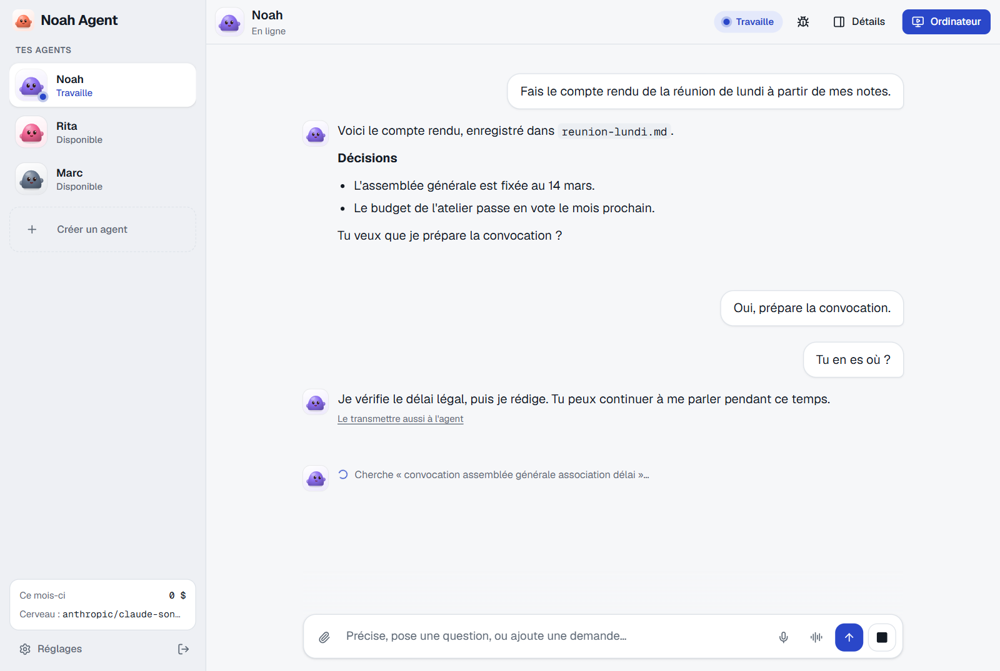
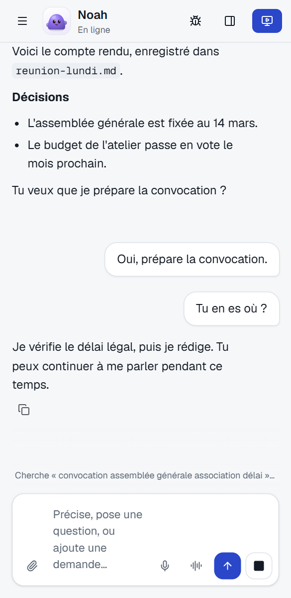
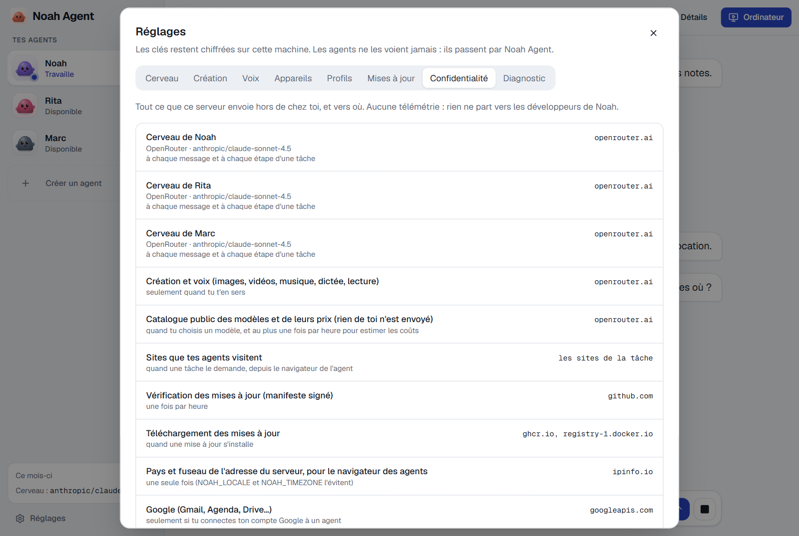

# Noah Agent

**Des assistants IA qui travaillent 24 h/24 sur ton propre serveur, pour qui veut les joindre de l'ordinateur et du téléphone sans confier ses conversations à un service tiers.**

[](LICENSE)

[Télécharger](#télécharger) · [Installer](#installer-sur-un-vps) · [Relier tes appareils](#relier-le-bureau-et-le-téléphone) · [Sécurité et vie privée](#sécurité-et-vie-privée) · [Comparer](#noah-ou-un-agent-hébergé) · [Bâtir](#bâtir-depuis-les-sources) · [Guide complet](docs/installation.md)

<p align="center">
  <br>
  <sub>Captures de la vraie interface, avec des réponses écrites d'avance et aucune donnée réelle.</sub>
</p>

## Télécharger

| Pour | Fichier | À quoi il sert |
|---|---|---|
| **Windows** | [noah-agent-windows-setup.exe](https://github.com/smfcoder17/noah-agent/releases/latest/download/noah-agent-windows-setup.exe) | L'application de bureau. Lance le fichier, puis relie-la à ton serveur. |
| **Android** (8 ou plus récent) | [noah-agent-android.apk](https://github.com/smfcoder17/noah-agent/releases/latest/download/noah-agent-android.apk) | L'application du téléphone. Ouvre le fichier sur le téléphone, puis autorise l'installation. |
| **Serveur** | [docker-compose.yml](https://github.com/smfcoder17/noah-agent/releases/latest/download/docker-compose.yml) | Le fichier à déployer sur ton VPS. C'est par lui que tout commence. |
| **iPhone, Mac, Linux** | Rien à télécharger | Ouvre l'adresse de ton Noah dans le navigateur. Sur iPhone, ajoute-la à l'écran d'accueil. |

> **Aujourd'hui, aucune version n'est publiée : ces trois liens ne répondent pas encore.** Seule l'[installation sur ton ordinateur](#bâtir-depuis-les-sources) marche pour l'instant. Noah est jeune : ce guide n'a pas encore été suivi sur un VPS neuf ni sur un vrai téléphone. [L'état réel, parcours par parcours](docs/etat.md).

Les applications ne font rien sans un serveur Noah : elles s'y relient. L'installateur Windows n'est pas signé, Windows peut donc afficher un avertissement au premier lancement. L'interface est en français.

## Installer sur un VPS

Il te faut un VPS Ubuntu ou Debian, 4 Go de mémoire au moins (plutôt 8 Go si plusieurs agents naviguent), 10 Go libres, et les ports 80 et 443 libres.

**1. Déploie Noah.** Choisis une voie.

- **Hostinger, sans commande.** Dans ton VPS : Docker Manager > Compose > « Compose from URL ». Colle l'adresse du fichier `docker-compose.yml` ci-dessus, nomme le projet `noah`, exactement, puis Deploy. Tu n'as pas encore de VPS ? Ce bouton [documenté par Hostinger](https://www.hostinger.com/support/deploy-on-hostinger-button/) mène à l'achat, puis au même fichier. Là aussi, nomme le projet `noah`. Nous ne l'avons pas encore essayé.

  [](https://www.hostinger.com/docker-hosting?compose_url=https://github.com/smfcoder17/noah-agent/releases/latest/download/docker-compose.yml)

- **Ailleurs, une commande,** en root sur le serveur. Elle installe Docker s'il manque et place Noah dans `/opt/noah`.

  ```sh
  curl -fsSL https://raw.githubusercontent.com/smfcoder17/noah-agent/main/get.sh | NOAH_DOMAIN=noah.exemple.com sh
  ```

  Sans sous-domaine, retire `NOAH_DOMAIN=noah.exemple.com`. Noah répond alors sur `<ip-en-tirets>.sslip.io`, et ton IP se lit dans l'adresse.

- **Confie-le à un agent** (Codex, Claude Code) : donne-lui l'adresse de ce dépôt et demande-lui de suivre [AGENTS.md](AGENTS.md).

**2. Ouvre le lien de création du compte.** Il s'affiche à la fin de la commande, ou dans les journaux du projet (View logs chez Hostinger). Il porte un code à usage unique.

**3. Laisse-toi guider.** Crée ton compte, choisis ton modèle et colle sa clé, crée ton premier agent. Sans clé en main, Ollama Cloud est le plus simple sur un VPS.

Un autre service tient déjà les ports 80 et 443 ? Lis [Derrière un Traefik](docs/installation.md#derrière-un-traefik). Pour choisir ton adresse : [Adresse et domaine](docs/installation.md#adresse-et-domaine).

## Relier le bureau et le téléphone

Chaque appareil demande ton accord, avec un nombre à 3 chiffres à recopier. Tu ne tapes pas ton mot de passe dans l'application pour la relier.

**Bureau (Windows).** Installe l'application, choisis « Sur mon serveur », saisis ton adresse en `https://`, puis « Relier ». Ton navigateur s'ouvre : clique sur « Autoriser cet appareil », puis recopie le nombre dans l'application.

**Android.** Installe l'APK.

1. Sur l'ordinateur, ouvre Noah : Réglages > Appareils > « Relier un appareil ». Un QR code s'affiche, valable 10 minutes.
2. Dans l'app, touche « Scanner le QR code ».
3. L'app affiche un nombre. Recopie-le sur l'ordinateur, puis clique sur « Autoriser ».

Pour recevoir les notifications sans service de Google, installe aussi l'app gratuite **ntfy** : c'est par elles qu'un agent te rappelle.

**iPhone ou autre.** Scanne le QR code avec l'appareil photo, ou ouvre ton adresse HTTPS, puis « Ajouter à l'écran d'accueil ». Il n'y a pas encore d'app iPhone.

## Ce que tu obtiens

<table>
<tr>
<td width="30%"></td>
<td>

- **Plusieurs agents, chacun chez lui.** Chaque agent a sa machine isolée, sa mémoire, ses fichiers et son navigateur.
- **Tu peux lui parler pendant qu'il travaille.** À l'écrit, ou à la voix avec une clé OpenRouter ou ton propre serveur de voix.
- **Il navigue et se sert de tes outils.** Une étape t'appartient, comme une connexion ou un CAPTCHA ? Il t'appelle, et tu prends la main sur son écran.
- **Il peut en solliciter un autre.** « Demande à Rita de… », et ajoute « rappelle-moi quand c'est fini ».
- **Le modèle de ton choix.** Ollama, un serveur compatible OpenAI, OpenRouter, Anthropic, OpenAI ou Gemini. Tes dépenses du mois sont affichées, et un plafond peut les arrêter. Ollama et les serveurs compatibles comptent 0 $, le plafond ne les arrête donc pas.
- **À plusieurs si tu veux.** Un profil par personne, et le partage d'un agent avec des droits.
- **Un serveur qui s'entretient.** Mises à jour seules à l'heure calme, avec sauvegarde avant et retour arrière en cas de panne. Tes [sauvegardes](docs/installation.md#sauvegarder) se restaurent ici ou sur un autre serveur.

</td>
</tr>
</table>

## Sécurité et vie privée

<p align="center">
  
</p>

### Où sont tes données

Sur ton serveur, dans des volumes Docker : ton compte et l'historique, les clés, puis la mémoire, les fichiers et le navigateur de chaque agent.

- **Les clés des fournisseurs et les jetons d'outils sont chiffrés.** Tes agents ne reçoivent jamais la clé du fournisseur : ils passent par le serveur, avec un jeton propre à chacun.
- **Les comptes que tu connectes pour un agent restent dans sa machine :** les sessions de son navigateur et sa connexion Google, par exemple.
- **Ton mot de passe n'est pas conservé,** seulement son empreinte (bcrypt).
- **Tes conversations, la mémoire et les fichiers ne sont pas chiffrés sur le disque.** La clé des secrets est sur le même serveur. Qui a un accès root à la machine, ton hébergeur compris, peut tout lire.
- **Une sauvegarde n'est pas chiffrée non plus,** et elle contient cette clé. Range-la en lieu sûr.

### Ce qui sort du serveur

Noah n'envoie rien à ses développeurs. Il n'a aucune télémétrie. Réglages > Confidentialité affiche la liste réelle chez toi.

| Quoi | Vers où | Quand |
|---|---|---|
| **Tes messages et ce que l'agent lit pour répondre** | Le fournisseur de modèle choisi. Personne avec un Ollama sur ta machine | À chaque message et à chaque étape d'une tâche |
| Voix, images, vidéos, musique | OpenRouter, ou ton serveur de voix | Quand tu t'en sers |
| Les pages visitées, avec l'IP du serveur | Les sites de la tâche | Quand une tâche le demande |
| Rien de toi : liste publique des modèles et des prix | openrouter.ai | Au plus une fois par heure |
| Rien de toi : recherche de mises à jour et téléchargement | github.com, ghcr.io, registry-1.docker.io | Une fois par heure, et à l'installation |
| Notifications, au contenu chiffré | Le service de ton appareil : Google, Apple, Mozilla, Microsoft ou ntfy | À chaque notification |
| Rien de toi : l'IP et le certificat du serveur | api.ipify.org (ifconfig.me, icanhazip.com en secours), Let's Encrypt | Au démarrage, puis tous les deux mois environ |
| Pays et fuseau du serveur | ipinfo.io | Une seule fois, évitable avec `NOAH_LOCALE` et `NOAH_TIMEZONE` |
| Ce que tu autorises sur ton compte Google | googleapis.com | Si tu connectes Google à un agent |
| Ce que l'agent envoie à un outil | Les outils que tu ajoutes. | Quand il s'en sert |

Chacun de ces services voit l'IP de ton serveur. Un test vérifie le serveur de Noah contre cette liste : [sorties_test.py](tests/exposition/sorties_test.py). Il ne voit pas ce que font les conteneurs des agents (Hermes), de leurs navigateurs et de Caddy. La mesure sur 24 h depuis un vrai VPS reste à faire.

### Comment tu restes le seul à entrer

- **Le compte.** Il se crée avec le code à usage unique du lien, puis ce code est effacé. Il n'y a pas d'inscription publique : toi seul peux ajouter un profil.
- **La connexion.** En HTTPS, avec 10 essais ratés au plus par réseau toutes les 10 minutes.
- **Les appareils.** Un QR code ou un code court sert une fois et expire en 10 minutes. Il ne suffit pas : tu acceptes sur un appareil déjà relié, avec le nombre à 3 chiffres. Réglages > Appareils les liste, et tu peux en retirer un.
- **Le réseau.** Seul Caddy publie des ports, le 80 et le 443. Le serveur, le lanceur, les agents et leurs navigateurs n'en publient aucun ([exposition_test.py](tests/exposition/exposition_test.py) lit les fichiers et les appels à Docker ; le scan depuis Internet reste à faire).
- **Les mises à jour.** Le serveur n'installe une version que si son manifeste porte la bonne signature, et chaque image y est fixée par empreinte.

### Ce que Noah ne protège pas

- **Pas de double authentification, ni de récupération du mot de passe par courriel.** Choisis un mot de passe long.
- **Un agent peut être trompé.** Une page ou un message piégé peut lui donner de fausses consignes, et il agit avec ce que tu lui as confié. Pour un outil branché, « Demander confirmation » est le droit par défaut. Il arrête le modèle, mais pas toujours un agent déjà détourné : [les limites](docs/installation.md#les-limites-à-connaître). Donne à chaque agent le moins d'accès possible.
- **Le lanceur a l'équivalent d'un accès root à la machine,** car il crée les conteneurs des agents par Docker. Il n'est pas exposé et chaque appel exige sa clé : [le détail](docs/installation.md#le-socket-docker).
- **Un sous-domaine ne cache pas ton serveur :** le DNS mène à l'IP. [Cacher l'IP](docs/installation.md#cacher-lip-du-serveur).
- **Un agent partagé garde une seule machine.** Ne le donne qu'à quelqu'un en qui tu as confiance.

Aucun audit externe n'a été fait. Tu trouves une faille ? Ouvre un ticket sans la décrire, et demande un moyen de contact privé.

## Noah ou un agent hébergé

Un agent hébergé est un service en ligne : tu crées un compte, et il tourne chez lui. Aucun des deux n'est meilleur partout.

| | Noah | Agent hébergé |
|---|---|---|
| **Pour commencer** | Louer un VPS, déployer, choisir un modèle | Un compte, tout de suite |
| **Où sont conversations et mémoire** | Sur ton serveur | Chez le service |
| **Qui peut les lire** | Ton hébergeur, et le fournisseur de modèle pour ce qu'il reçoit. Personne chez Noah | Le service, selon ses conditions |
| **Le modèle** | Celui que tu veux, local compris | Celui que le service propose |
| **Le coût** | Le VPS, plus ta consommation du modèle | L'abonnement ou l'usage |
| **Si ça tombe en panne** | C'est ton serveur, à toi de réparer | Le service s'en occupe |
| **Les applications** | Windows, APK Android hors Play Store, navigateur ailleurs | Souvent dans les magasins d'applications |
| **Le support** | Des tickets sur GitHub, pour un projet jeune | Celui du service |
| **Si tu pars** | Ta sauvegarde va sur un autre serveur | Selon ce que le service permet d'exporter |

**Prends un agent hébergé** si tu veux que ça marche ce soir, sans serveur à gérer. **Prends Noah** si garder la main sur tes données et ton modèle vaut cet entretien.

Noah est construit sur [Hermes Agent](https://github.com/NousResearch/hermes-agent). Il y ajoute plusieurs agents isolés, un navigateur par agent, des applications de bureau et Android, et des mises à jour avec retour arrière. Un seul agent dans ton terminal ou sur Telegram te suffit ? Hermes seul fera l'affaire.

## Bâtir depuis les sources

**Essayer sur ton ordinateur.** Installe [Docker Desktop](https://docs.docker.com/get-docker/) et démarre-le. Dans une copie de ce dépôt :

```sh
sh install.sh
```

Ouvre http://localhost:8080. Tout se compile chez toi, et Noah n'est pas ouvert au réseau. Pour mettre à jour : `git pull && sh install.sh`.

**Les applications.**

```sh
# Windows : l'installateur arrive dans desktop/dist/
cd desktop && npm install && npm run dist
```

```sh
# Android (Node 22, JDK 21, SDK Android) : l'APK de débogage arrive dans app/build/outputs/apk/debug/
cd mobile && npm ci && npx cap sync android
cd android && ./gradlew assembleDebug
```

**L'interface.** Le serveur doit tourner dans Docker : `cd frontend && npm install && npm run dev`, puis http://localhost:5173.

Le code : `server/` (API et comptes), `launcher/` (le seul service qui parle à Docker), `frontend/` (l'interface), `desktop/` et `mobile/` (les applications), `deploy/` (ce qui part sur un VPS). Pour comprendre l'ensemble : [le guide complet](docs/installation.md), [l'architecture](docs/architecture.html) et [la feuille de route](docs/roadmap.md).

## Contribuer

Un bug, une idée, une consigne fausse dans ce guide ? [Ouvre un ticket](https://github.com/smfcoder17/noah-agent/issues). Avant de proposer un changement, lance les tests en local :

```sh
node scripts/verifier.mjs
```

## Licence

[PolyForm Noncommercial 1.0.0](LICENSE). Le code est public et gratuit pour un usage personnel non commercial, et pour une école, une association caritative ou un organisme public. Un usage commercial demande un accord à part : ouvre un ticket.

Ce n'est pas une licence « open source » au sens de l'OSI, qui interdit de restreindre le commerce : tu peux lire le code, le modifier et l'installer, avec cette restriction. Les dépendances gardent leurs licences : [docs/licences.md](docs/licences.md).
