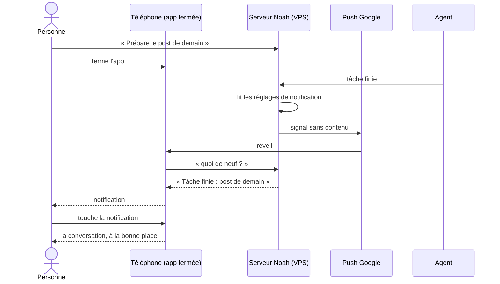
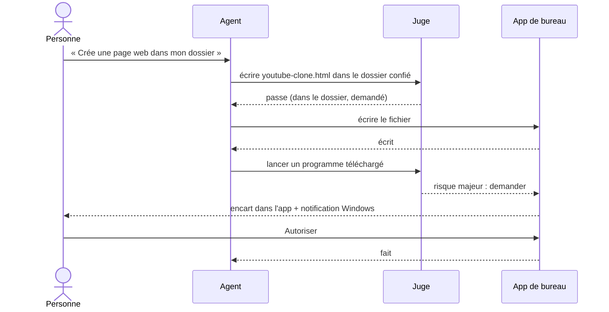
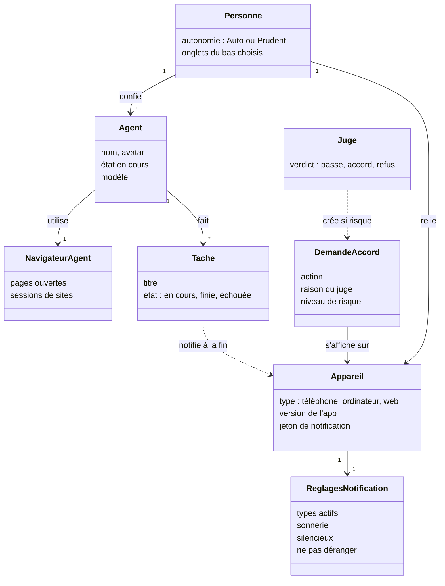

# Noah 0.1.6 : une app qui ne fait plus attendre ni demander pour rien

## L'histoire

En tant que personne qui confie son travail à Noah depuis son téléphone et son ordinateur, je veux une app mobile aussi simple et soignée que Muse, un agent qui agit sans me redemander ce que j'ai déjà demandé, un navigateur qui ne bloque pas, et des apps installées depuis les boutiques officielles, afin de ne plus perdre de temps et de faire confiance à Noah comme à une app premium.

## Le contexte

Aujourd'hui, l'écran de l'ordinateur de l'agent affiche souvent « Aucune page ouverte » alors qu'il y en a une. Changer d'onglet recharge tout, l'écran comme les listes. Le juge demande mon accord pour `date` dès que l'agent a lu une page qui contient des consignes, et le bureau ouvre des fenêtres Windows pour enregistrer un `.html` dans le dossier confié. Sur le téléphone, « Noah peut t'appeler » revient sans cesse, et je ne reçois jamais « tâche finie ». L'app mobile empile des onglets en haut et en bas, avec trop de texte. Le navigateur de l'agent montre des pages blanches. Windows avertit d'un « éditeur inconnu ». Dans Réglages, la version affichée est celle du serveur, pas celle de l'app.

## Critères d'acceptation

### Lot 1 : ce qui casse ou fait attendre

**Écran de l'ordinateur de l'agent**
- Étant donné que le navigateur de l'agent a une page ouverte, quand j'ouvre Ordinateur, alors l'écran s'affiche en moins de 3 s, sans ouvrir d'onglet séparé.
- « Aucune page ouverte » n'apparaît que si le navigateur n'a vraiment aucune page. Si l'écran ne répond pas, je vois « Écran injoignable » et un bouton pour réessayer, et il réessaie seul.
- Quand je passe à Compétences puis reviens à Ordinateur, alors l'écran est toujours là, sans reconnexion ni rechargement.
- Chaque onglet déjà vu s'affiche tout de suite avec ses données, puis se met à jour sans spinner.

**Juge et autorisations**
- En autonomie Auto, après que l'agent a lu une page qui contient des consignes, une commande sans effet au-dehors (`date`, lire, lister, calculer) passe sans me demander. Ne demandent encore que : envoyer ou publier quelque chose que je n'ai pas demandé, supprimer, payer, toucher un secret.
- Quand je demande « poste ceci sur X », alors l'agent publie ce que j'ai demandé sans autre accord. Si la page lue a tenté de lui donner des consignes, il me montre le texte exact avant de publier.
- Sur 20 tâches réelles tirées du journal du VPS (navigateur, X, dossier, terminal), au plus une demande d'accord, et uniquement sur un cas listé ci-dessus.

**Bureau : plus aucune fenêtre Windows**
- Créer, écrire (quel que soit le type, `.html` compris), déplacer ou ranger dans le dossier confié se fait sans fenêtre.
- Une demande d'accord qui reste nécessaire s'affiche dans l'app Noah, dans un encart dessiné par l'app de bureau elle-même (pas par le serveur), et une notification Windows m'y amène. Aucune boîte de dialogue système.
- En autonomie Auto, l'agent ne me demande rien sur l'ordinateur, sauf un risque majeur signalé par le juge (sortir du dossier confié, lancer un programme téléchargé, supprimer définitivement).

**Notifications et appels sur le téléphone**
- Aucune notification permanente « Noah peut t'appeler ».
- App fermée, téléphone verrouillé : « Tâche finie » arrive quand une tâche de plus de 30 s se termine, avec son titre, et l'ouvre au toucher.
- App fermée, écran éteint : un appel de Noah sonne comme un vrai appel (plein écran, sonnerie, Répondre / Refuser).
- Dans Réglages > Notifications : activer ou couper chaque type (tâches, accords, appels, messages), choisir la sonnerie, mode silencieux, plages « Ne pas déranger ».
- Le signal passe par le push Google via un relais sur mon VPS. Google ne voit qu'un signal sans contenu. Sans VPS (ordinateur seul ou app seule), l'app utilise ce qui est gratuit et disponible.

**Versions**
- Sur le téléphone, Réglages > Mises à jour affiche « Application 0.1.6 » et, en plus petit, « serveur 0.1.6 ». Pareil sur le bureau. Sur le web, seule la version du serveur.

### Lot 2 : l'app mobile refaite, façon Muse

- Aucune rangée d'onglets en haut de l'écran principal. En haut : ☰ à gauche, l'avatar et le nom de l'agent au centre avec son état (« Vérifie les diapositives »), une action à droite.
- En bas : des icônes seules. Par défaut : Discussion, Activité, Tâches, Fichiers, Ordinateur. Dans ☰, « Personnaliser » permet de choisir et d'ordonner ces onglets par un appui long.
- ☰ ouvre un tiroir : mes agents, mes espaces, la recherche et les réglages.
- Toucher l'avatar ouvre la page de l'agent en plein écran (✕ pour fermer) : modèle, connexions, compétences, mémoire, autonomie, apparence.
- Une routine, une veille, un fichier, un accord s'ouvrent chacun sur leur page, avec ← pour revenir.
- Réglages : une rangée par réglage (icône, nom, chevron) et au plus une ligne d'aide. Écran vide : une phrase.
- Sur les 8 écrans mesurés par `tools/eval/ecrans.mjs`, le nombre de mots visibles baisse d'au moins 40 % par rapport à la 0.1.5.
- Changer d'onglet prend moins de 300 ms sur un téléphone moyen, données déjà en cache.
- Trois juges, à l'aveugle, préfèrent les nouveaux écrans aux anciens et les placent au niveau de Muse ou au-dessus (banc de facilité, version 7).

### Lot 3 : le navigateur de l'agent

- On mesure, depuis le VPS, Camoufox et un vrai Chrome piloté par CDP (avec agent-browser) sur X, Instagram, Google, LinkedIn et 10 pages Cloudflare. Le vainqueur devient le navigateur de l'agent.
- L'agent dispose d'un relevé de page avec repères, de clics, saisie, onglets, attente, boîtes de dialogue, envoi et téléchargement de fichiers, et JavaScript.
- Sur 20 chargements de pages lourdes (X, Google Cloud, Instagram), aucune page blanche.
- Je vois toujours l'écran et je reprends la main comme aujourd'hui.
- Si on change de navigateur, mes sessions déjà ouvertes (cookies) sont reprises. Un site qui redemande la connexion me le dit une seule fois.

### Lot 4 : boutiques officielles

- **Play Store :** un paquet AAB signé, ciblant Android 16, avec le push Google ; la fiche, la politique de confidentialité, le formulaire sur les données, la déclaration du service d'appel avec sa vidéo ; un guide pas à pas pour créer le compte (25 $, que je paie), trouver 12 testeurs pendant 14 jours et demander la production.
- **Microsoft Store :** un paquet MSIX produit par la publication, signé par Microsoft une fois accepté ; la fiche ; le guide pour un compte individuel gratuit. L'installateur GitHub reste disponible, avec son avertissement.
- Les mises à jour arrivent par la boutique pour qui l'a installée par là.

## Hors-périmètre

- L'app iPhone : pas de boutique Apple dans cette version.
- Payer un certificat de signature : la personne refuse toute dépense pour Windows.
- Créer les comptes de boutique, payer, envoyer la soumission : gestes de la personne.
- CloakBrowser et nodriver : leurs licences ne permettent pas de les livrer avec Noah.
- Refaire l'app de bureau : elle reçoit seulement les corrections du lot 1 et les écrans communs.

## Diagramme de séquence : une tâche finie, app fermée

## Diagramme de séquence : l'agent agit sur l'ordinateur, autonomie Auto

## Diagramme de classes

## Questions ouvertes

1. **Clé du push Google sur chaque VPS.** Envoyer un push demande la clé du projet Firebase de Noah. La livrer dans chaque serveur veut dire qu'elle est publique. Elle ne permet d'envoyer qu'à un téléphone dont on connaît le jeton, et chaque jeton reste sur le serveur de son propriétaire. Risque : un abus ferait révoquer la clé pour tous. Proposition : une clé limitée à l'envoi, changée à chaque version, et le relais public UnifiedPush en secours.
2. **Appel plein écran.** Google Play réserve l'affichage plein écran aux apps d'appel et de réveil. Noah se déclare comme app d'appel ; un refus de Google ferait passer l'appel en notification prioritaire.
3. **Changement de navigateur.** Décidé par la mesure du lot 3, pas à l'avance.
