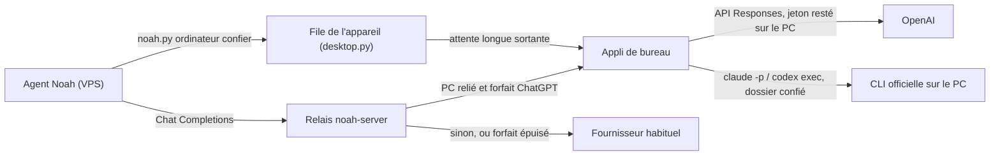

# 0.3.0 : utiliser son abonnement Claude ou ChatGPT par son ordinateur (recherche)

Recherche du 14 novembre 2026, puis premier lot de code le même jour (voir « État » ci-dessous). Les conditions citées sont celles lues ce jour-là ; elles ont changé trois fois en 2026 et peuvent encore changer.

Demande de Franck : « I want to be able to set my Noah agent on my VPS to use my subscription locally: it detects if I have a Claude subscription / ChatGPT and uses their proxy to allow me to use them from my local computer. So the address used is my own computer and it routes tasks/calls to it only if my computer is connected. »

## En bref (pour Franck)

1. **Claude : l'abonnement ne peut pas devenir le cerveau des agents Noah, mais il peut faire des tâches.** Anthropic interdit à un logiciel tiers de faire passer des requêtes par les identifiants d'un abonnement, et a déjà suspendu des comptes pour ça. En revanche, la personne a le droit de lancer la vraie CLI `claude`, installée et connectée par elle : l'appli de bureau peut donc confier une tâche entière à Claude Code sur son PC, dans un dossier confié, puis rendre le résultat à l'agent.
2. **ChatGPT : il existe une voie officielle pour en faire le cerveau.** Depuis septembre 2026, OpenAI laisse les applications open source et hébergées localement utiliser le forfait ChatGPT de la personne par l'API Responses (« Sign in with ChatGPT », plan usage), et `codex exec` est permis pour les tâches. Reste à savoir si Noah y a droit, car sa licence PolyForm Noncommercial n'est pas une licence open source au sens habituel.
3. **Tout passe par l'appli de bureau, en connexion sortante, et seulement quand le PC est allumé.** Sinon, Noah reprend le fournisseur habituel. On n'extrait jamais un jeton, on n'imite jamais un client officiel : c'est exactement ce qui fait suspendre les comptes.

## État : ce qui est fait, ce qui reste (14 novembre 2026, branche de l'agent)

Décisions de Franck appliquées : voie C pour Claude (tâches confiées, jamais le cerveau), voie D pour ChatGPT avec le **jeton sur le PC**.

### Fait

| Quoi | Où | Preuve |
|---|---|---|
| Détection de Claude Code par `claude auth status --json`, réduite à connecté, offre, méthode (ni e-mail ni organisation) | `desktop/claude.js` (`detect`, `locate` : `claude.exe` du PATH, celui de l'installation npm, ou `~/.local/bin`) | `tests/desktop/claude_test.mjs` |
| Tâche confiée : `claude -p --output-format stream-json --verbose`, consigne par l'entrée standard, dans un dossier confié en écriture ; outils fixés par l'app (« fichiers » : `--restricted --strict-mcp-config --tools Read,Glob,Grep,Edit,Write`, ou « complet » : + Bash, WebSearch, WebFetch, choisi sur le PC) ; `--permission-mode acceptEdits --permission-prompts none` ; une tâche à la fois ; délai (30 min par défaut) ; arrêt par Stop, par l'agent, par « Couper l'accès » (taskkill /T sous Windows, SIGINT puis SIGTERM ailleurs) | `desktop/claude.js`, action `claude` de `desktop/actions.js` | `claude_test.mjs` : 11 étapes vertes |
| Droit local « Laisser Noah confier des tâches à Claude Code », éteint par défaut, avec un avertissement sur les limites de l'abonnement ; Prudent : bandeau local par tâche (dossier, outils, durée, consigne entière) ; Auto : pas de bandeau sur le PC, le juge décide | menu de l'icône > Abonnements (`desktop/main.js`), `textes.js` | `claude_test.mjs` |
| Côté serveur : `noah.py ordinateur confier "consigne" --dossier X [--minutes N]`, `confier-attendre <id>`, `confier-arreter <id>` ; « en_cours » au-delà de 150 s (sous la limite de 180 s des commandes de l'agent) ; progression (`POST /api/desktop/progres/{id}`) ; refus lisibles (PC éteint, non installé, non connecté, non permis, déjà occupé, agent partagé) ; PC déconnecté en route : « tâche interrompue » avec la dernière étape | `server/noah/desktop.py`, `hermes.py`, consigne dans `main.py` | `tests/desktop/abonnements_test.py` |
| Juge : `ordinateur confier` est en ligne 6 (Auto et Prudent : accord ; Agir : passe) ; `confier-attendre` et `confier-arreter` ne demandent rien | `juge.py` (`DELEGATE`), `agent_plugin/__init__.py` | `abonnements_test.py`, `tests/tools/juge_test.py` toujours vert |
| Interface : « Claude Code sur ce PC : connecté, abonnement max » et l'état ChatGPT dans Réglages > Appareils ; dans la conversation, « Tâche confiée à Claude Code sur Bureau · abonnement max · dossier · durée », dépliable avec la progression et les fichiers, bouton Stop | `frontend/src/components/PhonePairing.tsx`, `DelegatedTasks.tsx`, `i18n/en/appareils.ts` | vitest : 37 fichiers, 129 tests verts ; build vert |
| ChatGPT : connexion officielle « Continue with ChatGPT » sur le PC (client `dynamic_agent_client` puis `oaiapp_…` rendu au retour, PKCE S256, `ext_agent_host_id` stable, retour sur `127.0.0.1`, état vérifié, jeton d'identité RS256 vérifié avec les clés de l'émetteur, portée `chatgpt.tokens.use.direct` exigée) ; jeton chiffré par `safeStorage` dans `chatgpt.bin`, renouvelé dans sa dernière minute ; liste des modèles du compte | `desktop/chatgpt.js` | `tests/desktop/chatgpt_test.mjs` : 10 étapes vertes, faux serveur OpenAI (`faux_openai.mjs`) |
| Traduction Chat Completions ↔ Responses (instructions, messages, images, appels et résultats d'outils, outils par `additional_tools`, `store:false`, `stream:true`, champs refusés retirés, historique d'outils réparé) | `desktop/responses.js` | `chatgpt_test.mjs` |
| Relais : avant la chaîne habituelle, un maillon « forfait ChatGPT par l'ordinateur » si un PC du propriétaire est en ligne, connecté et permis ; refus (limite du forfait → 429, panne, PC disparu) : maillon mis au repos (`modes.cool`, `modes.resting`) et le fournisseur habituel répond ; coût 0 $, noté « forfait ChatGPT · modèle » ; réponse entière ou en flux | `server/noah/relay.py`, `desktop.chatgpt_link`, `desktop.chatgpt_call` | `abonnements_test.py` (7a, 7b, 7c) |
| **De bout en bout** : vrai serveur dans Docker, vrai `noah.py`, vraie boucle du bureau, faux `claude`, faux OpenAI. L'agent confie, le bureau exécute, le résultat revient, l'agent lit le fichier produit ; tâche longue « en_cours » puis arrêtée en moins de 10 s ; un tour du cerveau passe par le forfait ; forfait épuisé puis PC déconnecté : le fournisseur habituel répond, rien ne part vers OpenAI | `tests/desktop/abonnements_reel.mjs` | 15 vérifications vertes |
| Essai réel du vrai `claude` (2.1.322, abonnement max) sur le PC de Franck : « crée liste.md triée à partir de notes.txt » dans un dossier temporaire | `desktop/claude.js` | `ok: true`, `liste.md` = « - kiwi / - poire / - pomme », 3 tours, 12 s, coût estimé 0,027 $, aucun autre fichier touché |

Reprise d'OmniRoute (MIT, commit `418cf3439b88a6318210bb1c819d55f6aa8513ee`), avis de licence et provenance en tête de `desktop/chatgpt.js` et `desktop/responses.js` : `open-sse/config/chatgpt.ts`, `src/lib/oauth/chatgptProtocol.ts`, `open-sse/services/tokenRefresh/providers/chatgpt.ts`, `open-sse/executors/chatgpt.ts`, et quelques fonctions de `open-sse/translator/request/openai-responses/toResponses.ts`. Écarté : le fournisseur Codex d'OmniRoute (`chatgpt.com/backend-api/codex/responses`, `client_id` et `originator` de la CLI Codex, en-têtes et empreintes copiés), ses fournisseurs par cookies web, et tout le reste.

### Reste à faire

- **Essai réel de ChatGPT** : rien n'a été envoyé au vrai `auth.openai.com`. L'inscription dynamique (`dynamic_agent_client`), la requête de renouvellement (non décrite par la doc lue, reprise d'OmniRoute) et le format exact d'`additional_tools` sont à vérifier avec un vrai compte. L'éligibilité de Noah (décision 3) reste ouverte.
- **Essai dans la vraie application Electron** : le menu Abonnements, la boîte d'avertissement et la connexion ChatGPT n'ont été lancés que par les tests (Electron simulé). Le bureau n'a pas été reconstruit.
- **Codex (`codex exec`)** : pas fait. Même schéma que Claude, à ajouter dans `claude.js` ou à côté.
- **Reprise de session** (`--resume`) : le `session_id` revient à l'agent mais aucun ordre ne le reprend.
- **Plafond de tâches par jour** réglé sur le PC, et liste des tâches dans l'Activité : pas faits.
- **Choix du modèle ChatGPT** : sur le PC (menu), le premier de la liste du compte par défaut ; pas affiché dans Réglages > Modèles.
- **Annonce à la personne** des 0 $ « forfait ChatGPT » dans l'Activité : la ligne existe dans `usage`, pas d'affichage à part.

### Doutes notés (Franck n'a pas pu être consulté)

- Prudent sur le PC et juge en Prudent ou Auto : la personne peut avoir deux accords pour une même tâche (carte du juge, puis bandeau local). J'ai gardé les deux : le bandeau local est le plancher qui ne dépend pas du serveur.
- « Lui passer tout ce qu'il peut » contre « pas de Bash par défaut » (décision 5) : par défaut « fichiers » ; « complet » (commandes et web) se choisit sur le PC, jamais par le serveur ni la consigne.
- Sans `--bare` (qui ignore l'abonnement), le profil « complet » charge le `CLAUDE.md` du dossier et les hooks de la personne ; le profil « fichiers » ignore ses réglages (`--restricted`) et tout serveur MCP (`--strict-mcp-config`).
- La phrase de l'Agent SDK (« offer claude.ai login or rate limits for their products ») reste à faire confirmer par Anthropic avant d'offrir la fonction à d'autres que Franck (décision 2).

## 1. Ce qui est permis, ce qui est risqué

### Anthropic (Claude Pro, Max, Ultra)

| Usage | Statut | Source |
|---|---|---|
| La personne lance elle-même `claude` ou `claude -p`, connecté avec son abonnement | **Permis.** Les limites annoncées supposent « ordinary, individual usage of Claude Code and the Agent SDK ». `claude -p` et l'Agent SDK puisent dans les limites de l'abonnement | https://code.claude.com/docs/en/legal-and-compliance ; https://support.claude.com/en/articles/15036540-use-the-claude-agent-sdk-with-your-claude-plan |
| Un logiciel tiers lance la CLI officielle, non modifiée, connectée par la personne elle-même | **Permis par le texte, à confirmer pour un produit distribué.** La page légale dit que la règle n'empêche pas une personne de se connecter « to the unmodified Claude Code binary with their own Claude subscription », même quand une plateforme héberge Claude Code. Mais la page de l'Agent SDK ajoute que les développeurs tiers ne peuvent pas « offer claude.ai login or rate limits for their products », sauf accord préalable | https://code.claude.com/docs/en/legal-and-compliance ; https://code.claude.com/docs/en/agent-sdk/overview |
| Un logiciel tiers récupère le jeton OAuth et appelle l'API avec (CLIProxyAPI, « claude-max-api-proxy », OpenCode avant janvier 2026) | **Interdit.** Anthropic ne permet pas « to route requests through Free, Pro, Max, or Ultra plan credentials on behalf of their users », ni de « collect, store, or intermediate Claude.ai credentials or session tokens ». Anthropic se réserve d'agir « without prior notice » | https://code.claude.com/docs/en/legal-and-compliance |
| Accès automatisé en général | Les conditions grand public l'interdisent, sauf par clé d'API « or where we otherwise explicitly permit it » (section 3, point 7). `claude -p` avec l'abonnement est explicitement permis par la documentation ci-dessus | https://www.anthropic.com/legal/consumer-terms |
| Partager son compte | Interdit : « You may not share your Account login information » (section 2). Donc un profil Noah partagé ou un autre compte ne doit jamais consommer l'abonnement de Franck | https://www.anthropic.com/legal/consumer-terms |
| Jeton longue durée `claude setup-token` | Il existe pour les scripts et la CI, il ne sert qu'aux requêtes de modèle. Le copier sur le VPS reviendrait à faire tourner Claude Code sur le serveur, pas à l'utiliser comme proxy. Hors de ce plan | https://code.claude.com/docs/en/authentication |

**Suspensions de comptes : le risque est réel.**

- Le 9 janvier 2026, Anthropic a bloqué les outils qui imitaient Claude Code (« tightened our safeguards against spoofing the Claude Code harness », Thariq Shihipar). Des comptes ont été suspendus automatiquement par les filtres d'abus ; Anthropic a dit annuler ces suspensions. Source : https://venturebeat.com/technology/anthropic-cracks-down-on-unauthorized-claude-usage-by-third-party-harnesses
- Le 20 février 2026, Anthropic a écrit la règle dans sa documentation ; OpenCode a retiré la connexion Claude à la suite de « anthropic legal requests ». Source : https://www.theregister.com/2026/02/20/anthropic_clarifies_ban_third_party_claude_access
- En avril 2026, la presse rapporte qu'OpenClaw, utilisé avec un abonnement Claude, devient payant à part (titre de https://www.techradar.com/pro/bad-news-claude-users-anthropic-says-youll-need-to-pay-to-use-openclaw-now ; je n'ai lu que le titre). Le centre d'aide d'Anthropic dit au contraire, depuis sa mise à jour de juin, que « third-party app usage » puise encore dans les limites de l'abonnement (https://support.claude.com/en/articles/15036540-use-the-claude-agent-sdk-with-your-claude-plan). Ces deux sources ne s'accordent pas ; aucune ne rend permis le proxy de jeton, que la page légale interdit.
- Je n'ai trouvé aucun cas publié de suspension due à CLIProxyAPI en particulier, ni de chiffre officiel. Les récits de suspensions viennent surtout de blogs.

**Conclusion pour Claude.** Un proxy qui fait de l'abonnement Claude le cerveau d'un agent Noah est interdit et expose le compte. Faire lancer la CLI officielle sur le PC de la personne, pour sa propre tâche, est la seule voie défendable. Pour l'usage de Franck seul, le risque est faible. Pour une fonction offerte à tous les utilisateurs de Noah, la phrase de l'Agent SDK laisse un doute : seule une réponse écrite d'Anthropic le lève.

### OpenAI (ChatGPT Plus, Pro)

| Usage | Statut | Source |
|---|---|---|
| `codex exec` lancé sur son ordinateur, avec la connexion ChatGPT enregistrée | **Permis.** « codex exec reuses saved CLI authentication by default ». OpenAI recommande une clé d'API pour la CI, et la connexion ChatGPT « only if you specifically need to run as your Codex account » | https://learn.chatgpt.com/docs/non-interactive-mode |
| Une application open source ou hébergée localement utilise le forfait ChatGPT par l'API Responses (OAuth officiel, « Continue with ChatGPT ») | **Permis, sur inscription.** « ChatGPT plan usage for open-source and locally hosted apps ». Les applications payantes ou hébergées à distance remplissent un formulaire d'intérêt. L'accès ne donne ni les conversations ni une clé d'API | https://developers.openai.com/siwc/token-sharing-open-source.md ; https://developers.openai.com/siwc/quickstart.md |
| La même chose sur une machine distante (VPS) | **Prévu par OpenAI** : la connexion se fait sur l'ordinateur local, puis le fichier d'identifiants est copié sur la machine distante par un canal sûr. Limites : pas encore de révocation pour une session transférée | https://developers.openai.com/siwc/token-sharing-open-source/self-hosted-vms.md |
| Appeler les points d'accès internes de ChatGPT (`backend-api`) avec le jeton de Codex, comme certains proxys | **À éviter.** La doc officielle dit de ne pas « point it at ChatGPT's `backend-api` endpoints ». Un changement côté OpenAI a déjà cassé ces montages | https://developers.openai.com/siwc/token-sharing-open-source/models-and-inference.md |
| Fichier `~/.codex/auth.json` | À traiter comme un mot de passe : « Don't commit it, paste it into tickets, or share it in chat » | https://learn.chatgpt.com/docs/auth |

L'équipe Codex a publiquement soutenu l'usage de l'abonnement dans des outils tiers (Thibault Sottiaux, cité par https://www.theregister.com/2026/02/20/anthropic_clarifies_ban_third_party_claude_access). Le risque de suspension côté OpenAI est faible par la voie officielle. Il reste une question d'éligibilité, pas de sécurité du compte.

**Contraintes techniques de la voie officielle** (https://developers.openai.com/siwc/token-sharing-open-source/preview-limitations.md) : API Responses seulement, `store: false` et `stream: true` obligatoires, pas de message `system`, pas de `temperature` ni de `max_output_tokens`, outils de fonction groupés en espaces de noms, pas d'outils hébergés (recherche de fichiers, interpréteur, computer use). Les dépassements de forfait arrivent en cours de flux (`subscription_sharing_usage_limit_exceeded`).

## 2. D'où part Noah (lu dans le code)

| Brique | Où | Ce qui compte ici |
|---|---|---|
| Relais de modèle | `server/noah/relay.py` | Les agents Hermes n'appellent jamais un fournisseur : ils parlent à `/relay/v1` en Chat Completions. Le relais choisit la clé, mesure le coût et passe au maillon suivant de la chaîne sur une erreur de `modes.FAILOVER` (402, 429, 5xx…), avec `modes.cool`. C'est là que se branche le retour au fournisseur habituel |
| Fournisseurs | `server/noah/providers.py`, `hermes.PROVIDERS` | Liste fermée : OpenRouter, Anthropic, OpenAI, Gemini, Mistral, DeepSeek, Mammouth, Ollama, Ollama Cloud, compatible OpenAI. Aucun ne parle l'API Responses |
| Boucle de l'agent | `hermes.configure` | L'agent a sa propre boucle et ses outils sur le VPS (terminal, Camoufox, `noah.py`). Il lui faut un modèle brut avec appels d'outils, pas un autre agent |
| Canal vers le PC | `server/noah/desktop.py`, `desktop/actions.js` | File par appareil, attente longue sortante (`GET /api/desktop/next`, 25 s), battement (`/api/desktop/battement`), résultat en un seul envoi (`/api/desktop/result/{rid}`), délai de réponse 300 s. Aucun port ouvert sur le PC. Pas encore de flux continu |
| Droits et accords locaux | `desktop/dossiers.js`, `autonomie.js`, `bandeau.js`, `actions.js` (`commande`) | Les droits vivent sur le PC ; un serveur compromis ne peut pas les élargir. `commande` montre déjà le dossier, le programme et les arguments avant `execFile` |
| Agent partagé | `desktop._gatekept` | Un agent partagé n'atteint aucun appareil. À garder tel quel |

Vérifié sur le PC de Franck le 14 novembre : `claude auth status --json` rend `loggedIn`, `authMethod` (`claude.ai`), `subscriptionType` (`max`) et `apiProvider`, sans jeton ; `codex login status` rend « Logged in using ChatGPT ». La détection n'a donc pas besoin de lire un fichier d'identifiants.

## 3. Les voies possibles

| Voie | Ce qu'elle donne | Conditions | Technique | Verdict |
|---|---|---|---|---|
| **A. Proxy du jeton** (CLIProxyAPI, 58 k étoiles, MIT ; il expose Claude Code, Codex, Gemini en API compatible OpenAI) | L'abonnement comme cerveau de tous les agents | Claude : interdit, suspensions connues. ChatGPT : passe par des points d'accès privés | Simple, mais casse à chaque changement côté éditeur | **Écartée** |
| **B. La CLI comme moteur de texte** (`claude -p` sans outils, pour chaque tour de l'agent Hermes) | Un cerveau Claude, en apparence | Revient à faire passer les requêtes d'un produit tiers par l'abonnement : même interdiction que A, par un autre chemin | Mauvaise : un processus par tour (plusieurs secondes), consigne de Claude Code en plus, pas d'appels d'outils natifs | **Écartée** |
| **C. Confier une tâche à la CLI sur le PC** (`claude -p`, `codex exec`) | Claude Code ou Codex fait une tâche entière sur le PC, avec ses propres outils, dans un dossier confié ; l'agent Noah reçoit le compte rendu | Claude : permis pour la personne, à confirmer pour un produit distribué. Codex : permis | Le canal `desktop.py` existe ; il manque le flux continu et les tâches longues | **Recommandée pour Claude et ChatGPT** |
| **D. Forfait ChatGPT officiel comme cerveau** (API Responses, OAuth « Continue with ChatGPT ») | Un vrai cerveau ChatGPT pour les agents Noah, avec tous leurs outils sur le VPS | Permis aux applications open source ou hébergées localement ; éligibilité de Noah à confirmer | Traduction Chat Completions ↔ Responses dans le relais | **Recommandée pour ChatGPT, si OpenAI accepte Noah** |

## 4. Architecture proposée

### Le principe : des paliers, comme pour le navigateur

Même logique que la section E de `navigateur.md` : le socle marche sans rien, et l'ordinateur ajoute un palier quand il est là.

| Ce que la personne a | Cerveau de l'agent | Tâches confiées |
|---|---|---|
| Le VPS seul, ou PC éteint | Fournisseur habituel (clé dans Réglages) | Aucune ; l'agent fait tout lui-même |
| PC allumé, appli ouverte, `claude` connecté | Fournisseur habituel | Claude Code sur le PC (voie C) |
| PC allumé, `codex` connecté | Fournisseur habituel | Codex sur le PC (voie C) |
| Forfait ChatGPT relié (voie D) | ChatGPT par le forfait, puis le fournisseur habituel en secours | Codex si le PC est là |

### Détection sur l'ordinateur

- Au démarrage puis toutes les 10 minutes, l'appli lance `claude auth status --json` et `codex login status`, sans shell, avec un délai court. Elle cherche les exécutables dans le `PATH` et aux emplacements d'installation connus.
- Le battement envoie seulement : `claude: {installé, connecté, offre: "max"}`, `codex: {installé, connecté: "chatgpt"}`. Jamais d'e-mail, d'organisation, de chemin ni de jeton.
- L'appli ne lit jamais `~/.claude/.credentials.json` ni `~/.codex/auth.json`. Si la CLI n'est pas connectée, elle propose « Se connecter » : cela ouvre `claude auth login` ou `codex login` dans un terminal visible, et la personne termine la connexion chez l'éditeur. La règle d'Anthropic l'exige : « sign-in to a Claude account must complete through Anthropic's own flow ».

### Voie C : confier une tâche

**Côté agent.** Un nouvel ordre fermé, sur le modèle des autres : `noah.py ordinateur confier --outil claude|codex --dossier <confié> "consigne"`. Il n'existe dans la consigne de l'agent que si un PC du même compte est en ligne avec l'outil connecté. Sinon, l'agent reçoit une erreur lisible (« L'ordinateur est éteint : fais la tâche toi-même ») et continue avec son cerveau habituel.

**Côté PC.** L'appli lance la CLI avec `execFile`, jamais par un shell, dans le dossier confié :

- Claude : `claude -p <consigne> --output-format stream-json --verbose`, avec un mode de permission et une liste d'outils fixés par l'appli (par défaut lecture et édition dans le dossier, sans `Bash`). `--bare` est exclu : ce mode ne lit pas la connexion de l'abonnement (https://code.claude.com/docs/en/headless). Sans `--bare`, la CLI charge les hooks, les serveurs MCP et le `CLAUDE.md` du dossier et de `~/.claude` ; le dossier confié ne doit donc pas porter de `.claude/` ou de `.mcp.json` inconnus. Les options pour n'en charger aucun sont à vérifier au lot 0.
- Codex : `codex exec --json --sandbox workspace-write`, dans le même dossier ; jamais `danger-full-access`.
- Le flux d'événements (JSONL) remonte au serveur par morceaux, et l'agent voit l'avancement. Le résultat final (texte, fichiers modifiés, coût estimé et `session_id`) clôt la demande. Une suite (« corrige encore ceci ») reprend la session avec `--resume` ou `codex exec resume`.

**Ce qu'il faut ajouter au canal.** Les demandes actuelles attendent 300 s au plus, pour un seul résultat. Une tâche confiée peut durer 30 minutes. Il faut donc : un envoi de progression (`POST /api/desktop/progres/{rid}`), un plafond de durée réglé sur le PC, et un arrêt qui envoie SIGINT à la CLI, puis SIGTERM. L'attente longue sortante reste le transport : aucun port n'est ouvert sur le PC.

### Voie D : le forfait ChatGPT comme cerveau

- **Connexion.** L'appli de bureau fait l'OAuth officiel « Continue with ChatGPT » : le retour sur `127.0.0.1` arrive sur le PC, comme le prévoit OpenAI. Elle garde le jeton dans le coffre du système (Windows Credential Manager), avec un `ext_agent_host_id` stable.
- **Où partent les requêtes : deux variantes, à choisir par Franck.**
  - *Jeton sur le PC* (ce que Franck décrit) : le relais transmet le tour de l'agent à l'appli, qui appelle `https://api.openai.com/v1/responses` et renvoie le flux. Les requêtes partent de chez la personne, ce qui colle à « hébergée localement ». PC éteint : le relais saute ce maillon. Coût : une latence de plus, et un canal de flux continu dans les deux sens (WebSocket sortant).
  - *Jeton sur le serveur* (guide « Self-hosted VMs » d'OpenAI) : l'appli envoie le fichier d'identifiants au serveur une fois, puis le serveur appelle OpenAI lui-même. Plus simple, et ça marche PC éteint. Mais OpenAI ne permet pas encore de révoquer une session transférée, et une application « remotely hosted » relève du formulaire d'intérêt.
- **Dans le relais.** Un fournisseur `chatgpt-forfait` traduit Chat Completions en Responses : `messages` vers `input`, `system` vers `instructions`, outils de fonction groupés en espace de noms, champs refusés retirés, flux traduit dans l'autre sens. Le maillon entre dans la chaîne de `modes` ; `subscription_sharing_usage_limit_exceeded`, un 429 ou un PC absent le mettent au repos (`modes.cool`), et le maillon suivant prend le relais. Le coût enregistré vaut 0 $, avec la mention « forfait ChatGPT ».

### Routage côté serveur

- Un maillon « par l'ordinateur » n'est candidat que si `desktop._online(appareil)` est vrai pour un PC **du propriétaire de l'agent** et que le battement annonce l'outil connecté.
- Un agent partagé, un profil invité ou un autre compte n'y ont jamais accès (`_gatekept`, même compte uniquement). C'est aussi une condition des éditeurs : un abonnement ne se partage pas.
- Si le PC se déconnecte au milieu d'un tour du cerveau (voie D), le relais rejoue le tour chez le fournisseur suivant. Au milieu d'une tâche confiée (voie C), l'agent reçoit « ordinateur déconnecté, tâche interrompue » avec la dernière progression, et décide de reprendre lui-même.

### Sécurité : qui peut lancer quoi sur l'ordinateur

| Niveau | Règle |
|---|---|
| Droit par outil | Sur le PC, dans l'appli : « Autoriser Noah à confier des tâches à Claude Code » et « … à Codex », éteints par défaut. Le serveur ne peut pas les allumer (même principe que `dossiers.js`) |
| Dossier | Une tâche ne part que d'un dossier confié avec droit d'écriture. Jamais le dossier personnel entier, ni un chemin réseau (règle `UNC` de `actions.js`) |
| Accord | Prudent : chaque tâche s'affiche dans le bandeau local (outil, dossier, consigne en entier, nettoyée par `clean`, refusée si trop longue par `tooLong`), avec un accord à usage unique. Auto : accord une fois par dossier et par outil, révocable |
| Plancher | Les outils permis à la CLI sont fixés par l'appli, pas par la consigne ; pas de `Bash` par défaut, pas de mode qui saute les permissions. Codex reste en `workspace-write` |
| Injection | La consigne vient d'un agent qui a pu lire une page piégée. Le juge (`juge.py`) classe `confier` en ligne 6 (effet hors de Noah), le tour est durci après une lecture extérieure (`READS_OUTSIDE`), et la consigne reste visible en entier avant l'accord |
| Arrêt | « Couper l'accès » (`main.js`) tue aussi les CLI en cours. Le journal des actions garde : agent, outil, dossier, durée, résultat |

### Coût et limites des abonnements

- Les abonnements ont des limites d'usage, pas un prix au jeton. Une longue tâche d'agent peut épuiser la fenêtre de Claude Max en peu de temps, et cette fenêtre est la même que celle de Franck dans son terminal. Noah doit le dire avant de lancer, et proposer un plafond de tâches confiées par jour, réglé sur le PC.
- `claude -p --output-format json` rend un `total_cost_usd` estimé côté client (https://code.claude.com/docs/en/headless) : on l'affiche comme équivalent, jamais comme dépense.
- Le budget mensuel de Noah ne compte pas ces appels (0 $), mais l'Activité les liste à part.

### Ce qu'on montre dans l'interface

- **Réglages > Modèles et budget > Mes abonnements** : pour chaque PC, « Claude Code : connecté (Max) », « Codex : connecté (ChatGPT) », ou « non installé » avec un lien d'aide. Les interrupteurs eux-mêmes vivent dans l'appli de bureau.
- **Écran Ordinateur** : le palier actif (« Cerveau : ChatGPT par ton forfait, via Mon PC » ou « PC éteint : modèle habituel »), et la tâche confiée en cours avec son dossier, sa durée et un bouton Stop.
- **Conversation** : une ligne « Tâche confiée à Claude Code sur Mon PC (abonnement) », dépliable avec la progression.
- **Nom et logo.** Anthropic permet de dire en texte clair que le produit « runs Claude Code », mais pas d'utiliser ses noms ou logos comme nom de fonction (https://code.claude.com/docs/en/legal-and-compliance). Libellé : « Confier à Claude Code », sans logo. OpenAI impose « Continue with ChatGPT » et sa charte pour le bouton de connexion (https://developers.openai.com/siwc/quickstart.md).

### Tâche longue ou simple réponse

| Besoin | Voie | Ce qui marche | Ce qui ne marche pas |
|---|---|---|---|
| Réponse texte, conversation, décision | D (ChatGPT) | Tout : c'est le cerveau normal de l'agent | Claude : impossible par l'abonnement |
| Tâche longue de l'agent avec ses outils (navigateur Camoufox, fichiers du VPS, `noah.py`, routines) | D | Les outils restent ceux de Noah sur le VPS | Recherche de fichiers, interpréteur et computer use hébergés d'OpenAI |
| Tâche de code ou de fichiers sur le PC | C (Claude ou Codex) | Lecture et édition dans le dossier confié, recherche web de la CLI, reprise de session | Le navigateur de l'agent, les fichiers du VPS, les connexions de Noah : la CLI ne les voit pas. Les fichiers reviennent par `ordinateur lire` |
| Routine la nuit, PC éteint | Socle | Fournisseur habituel | C et D par le PC |

## 5. Étapes et estimation

Chaque lot suit le workflow Feature. Le lot 0 passe par /proto, avec un GO ou NO-GO de Franck.

| Lot | Contenu | Fini quand | Durée |
|---|---|---|---|
| 0. Spike | Détection dans l'appli ; une tâche `claude -p` et une `codex exec` lancées depuis le serveur dans un dossier de test ; flux JSONL remonté | Sur le PC de Franck : détection juste pour les 2 outils, 3 tâches réussies par outil, temps de démarrage mesuré, liste de ce que `claude -p` charge sans `--bare` | 1 jour |
| 1. Détection et écran | Battement enrichi, Réglages > Mes abonnements, palier dans l'écran Ordinateur | Tests : rien de privé dans le battement ; un autre compte ne voit rien ; PC éteint, l'état passe à « éteint » en moins de 40 s | 1 à 2 jours |
| 2. Tâches confiées (voie C) | `ordinateur confier`, progression, plafond de durée, Stop, accords locaux, droit par outil, ligne du juge, journal | Tests : agent partagé refusé ; sans accord, rien ne démarre ; Stop tue la CLI en 5 s ; la consigne d'une page piégée ne lance rien sans accord ; une tâche de 20 minutes aboutit | 3 à 4 jours |
| 3. Forfait ChatGPT (voie D) | Inscription OAuth, coffre du système, fournisseur `chatgpt-forfait`, traduction Responses, maillon de la chaîne, variante choisie | Tests : un agent fait un tour avec outils par le forfait ; forfait épuisé ou PC éteint, le tour suivant part chez le fournisseur habituel sans erreur visible ; aucun jeton dans les journaux | 5 à 7 jours, plus 2 à 3 pour la variante « jeton sur le PC » |
| 4. Flotte de test | Parcours réel sur un PC propre et le VPS de Franck | Rapport de la flotte, captures | 1 jour |

Total : environ 2 semaines et demie. Le lot 3 attend la réponse d'OpenAI sur l'éligibilité.

## 6. Décisions qui restent à Franck

1. **Claude comme cerveau : non.** J'écarte les voies A et B à cause de la règle d'Anthropic et des suspensions connues. Il me faut ton accord, car c'est ce que tu imaginais (« uses their proxy »).
2. **Claude en tâches confiées : pour toi seul, ou pour tous ?** Pour tous les utilisateurs, je propose d'écrire d'abord à Anthropic (https://www.anthropic.com/contact-sales, le contact que donne la page légale). Leur doc de l'Agent SDK interdit aux produits tiers d'« offer claude.ai login or rate limits ».
3. **ChatGPT : demander l'accès.** La licence PolyForm Noncommercial de Noah n'est pas une licence open source au sens de l'OSI. Au choix : remplir le formulaire d'intérêt d'OpenAI, ou réserver la voie D aux installations personnelles et ne pas l'activer d'office.
4. **Où vit le jeton ChatGPT** : sur le PC (seulement quand il est allumé, comme tu l'as décrit), ou sur le serveur (marche toujours, mais pas encore révocable).
5. **Le plancher des tâches confiées** : pas de `Bash` par défaut et un accord par tâche en Prudent. C'est une règle de sécurité, donc ta décision.

## 7. Ce qui n'est pas vérifié

- Je n'ai lancé aucune tâche par `claude -p` ou `codex exec` depuis Noah. J'ai seulement lu `claude auth status --json` et `codex login status` sur le PC de Franck.
- Je n'ai pas vérifié quelles options de `claude -p` évitent de charger les hooks, les MCP et le `CLAUDE.md` de la personne sans passer par `--bare`.
- Je n'ai pas vérifié si Hermes sait parler l'API Responses directement : la traduction dans le relais suppose que non.
- La page d'aide d'OpenAI sur l'usage du forfait dans d'autres applications (https://help.openai.com/en/articles/20001542-using-your-chatgpt-plan-in-other-apps-and-sites) a refusé la lecture automatique (403). Ce qu'elle dit vient de résumés de recherche.
- Les conditions d'utilisation d'OpenAI (https://openai.com/policies/row-terms-of-use/) ont refusé la lecture automatique (403). Je ne cite donc aucune de leurs clauses.
- La presse de février citait une phrase d'Anthropic qui nommait l'Agent SDK parmi les usages interdits. La page légale lue le 14 novembre ne la contient plus sous cette forme : c'est la version actuelle qui fait foi ici.
- Les suspensions de janvier 2026 et leur annulation sont rapportées par la presse ; Anthropic n'a pas publié de chiffre.

## Sources

- Anthropic, page légale de Claude Code : https://code.claude.com/docs/en/legal-and-compliance
- Anthropic, conditions grand public (en vigueur depuis le 8 octobre 2025) : https://www.anthropic.com/legal/consumer-terms
- Anthropic, Agent SDK : https://code.claude.com/docs/en/agent-sdk/overview
- Anthropic, mode non interactif : https://code.claude.com/docs/en/headless
- Anthropic, authentification : https://code.claude.com/docs/en/authentication
- Anthropic, centre d'aide, Agent SDK et abonnement : https://support.claude.com/en/articles/15036540-use-the-claude-agent-sdk-with-your-claude-plan
- OpenAI, Sign in with ChatGPT : https://developers.openai.com/siwc/quickstart.md ; https://developers.openai.com/siwc/token-sharing-open-source.md ; https://developers.openai.com/siwc/token-sharing-open-source/self-hosted-vms.md ; https://developers.openai.com/siwc/token-sharing-open-source/models-and-inference.md ; https://developers.openai.com/siwc/token-sharing-open-source/preview-limitations.md ; https://developers.openai.com/siwc/token-sharing-open-source/codex-app-server.md
- OpenAI, Codex : https://learn.chatgpt.com/docs/auth ; https://learn.chatgpt.com/docs/non-interactive-mode
- Presse : https://venturebeat.com/technology/anthropic-cracks-down-on-unauthorized-claude-usage-by-third-party-harnesses ; https://www.theregister.com/2026/02/20/anthropic_clarifies_ban_third_party_claude_access ; https://www.techradar.com/pro/bad-news-claude-users-anthropic-says-youll-need-to-pay-to-use-openclaw-now
- CLIProxyAPI (MIT, 58,6 k étoiles le 14 novembre 2026) : https://github.com/router-for-me/CLIProxyAPI
