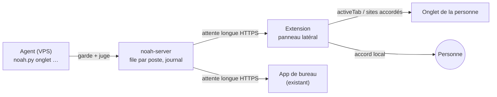

# 0.3.0 : agir dans le navigateur et sur l'ordinateur de la personne (recherche)

Recherche du 13 novembre 2026, sans code changé. Rien n'a été mesuré sur Noah dans ce document. Chaque lot proposé prouve son changement par un test.

## En bref

1. **La capacité.** Le post est l'annonce de Grok Bot 1.0 (xAI, 11 novembre 2026). Il montre des « coéquipiers IA » qui travaillent sur **leur propre ordinateur dans le cloud**, avec un curseur visible, une pilule vocale sur le bureau, et une présence dans Slack, Teams et les réunions. Chez Grok Bot, agir sur l'ordinateur de la personne n'est qu'une option, réglée sur « demander à chaque fois ». Noah a déjà l'essentiel de ce modèle (un ordinateur par agent, la prise en main). Ce qui lui manque vraiment : agir dans **le navigateur de la personne**, avec ses sessions.
2. **Le cas retenu.** « Remplis ce formulaire pour moi » sur la page où elle se trouve (devis, inscription, réclamation, résiliation). Noah remplit sous ses yeux, et l'envoi reste à elle.
3. **La voie recommandée.** Une extension Chrome/Edge reliée au serveur comme un appareil de plus. Chrome lui-même limite l'accès à l'onglet confié, puis aux sites accordés. Les accords s'affichent dans l'extension, jamais dans la page du serveur. Le pilotage de tout le système (computer use) vient plus tard.
4. **Le premier lot.** Une maquette en lecture seule : une extension non publiée et `noah.py onglet lire`, essayées sur le PC de Franck, avec la mesure des jetons sur 10 vraies pages.
5. **Décisions pour Franck.** (a) Publier une extension sur le Chrome Web Store et Edge Add-ons. (b) Dans le navigateur de la personne, un envoi, un paiement ou une publication se confirme toujours sur place, même en mode Agir.

## 1. Ce que montrent le post et la vidéo

**Source.** https://x.com/bot/status/2120582957782200586. x.com refuse la lecture automatique (HTTP 402) ; texte et données lus par `api.fxtwitter.com`.

- Auteur : Grok Bot (@bot), organisation vérifiée. Date : mercredi 11 novembre 2026, 18:22 UTC.
- Texte du post : « Introducing Grok Bot 1.0. AI teammates that work alongside your whole team. Share Bots, collaborate with them in Slack and Teams, invite them to meetings, and watch them learn and become more helpful. »
- Vidéo : 79 s, 1920×1080, 55 millions de vues.

**Ce que j'ai vu moi-même.** J'ai ouvert le fichier MP4 dans le navigateur intégré et capturé des images à 0:02, 0:05, 0:08, 0:11, 0:15, 0:18, 0:22, 0:25, 0:27, 0:29, 0:32, 0:37, 0:39, 0:42, 0:44, 0:46, 0:48, 0:51, 0:53, 0:56, 0:58, 1:01, 1:06, 1:11 et 1:16. Je n'ai pas écouté le son.

| Moment | Ce qu'on voit |
|---|---|
| 0:02 | Un message de « Launch Bot » : « New headphones launching in 2 weeks. Created a channel to keep us on track. » Le bot prend l'initiative |
| 0:05 | « Introducing Grok Bot beta » |
| 0:08 à 0:11 | **Une pilule flottante** : l'avatar du bot, une onde vocale, et les boutons réglages, chat, micro et raccrocher. On lit « Hey, can you join the call at 10? », puis « Of course. » |
| 0:15 à 0:18 | Une visioconférence à quatre tuiles, dont une pour « Research Bot » |
| 0:22 à 0:32 | Research Bot écrit « Let me look up the latest tester feedback », puis **son propre curseur** (une flèche avec la mascotte) parcourt un graphique « 80 testers… Lightness 89 % ». Il demande « Want me to ping marketing? », et quelqu'un répond d'un pouce |
| 0:37 | Dans Slack, en tant qu'APP : « @marketing Can we work this feedback into the ad concepts? cc @Copy Bot ». Un bot fait appel à un autre |
| 0:39 à 0:48 | Plusieurs bots ; **un curseur de bot** modifie un calque « Headline » dans un outil de design (genre Figma) ; le visuel « A lighter fit for longer days » se crée |
| 0:51 | « Knows your business » |
| 0:56 à 1:01 | Un curseur de bot sur un deck « Year one: $8M ». Dans la pilule : « Can you share the deck with the ad agency? », puis « Sure. Heads up, slide 6 has sensitive financials. Want me to send it without that? » |
| 1:06 à 1:16 | Réactions sur l'annonce publiée, « Say hi to your new… », logo Grok Bot |

**Ce que disent les autres sources.**

- La page produit https://x.ai/bot : chaque Bot a « its own computer », un « cloud computer » qui continue quand l'ordinateur portable est fermé. Applications de bureau et iOS. Après une connexion, le Bot « uses your apps and websites just like you would ». Approbations, « Auto Review » des actions sensibles, apprentissage d'une tâche montrée une fois. De 30 à 200 $ par mois.
- L'analyse détaillée de Flavio Copes (https://flaviocopes.com/grok-bot/, source tierce) : l'application de bureau est un client de l'ordinateur cloud. « Grok Bot can request access to the local computer, but the default permission is to ask every time. » L'option « Route traffic through this computer » fait sortir le trafic du cloud par le bureau de la personne. Pour apprendre une tâche, on enregistre jusqu'à 10 minutes ; il en sort un brouillon de compétence à relire. La prise en main sert à la connexion, au 2FA et aux CAPTCHA. « Two Bots are not separate security boundaries. »
- La presse date la bêta du 11 août 2026, avec Cursor ([unite.ai](https://www.unite.ai/xai-launches-grok-bot-always-on-ai-teammates-with-their-own-cloud-computers/), [VentureBeat](https://venturebeat.com/orchestration/spacexais-grok-bot-turns-agents-into-persistent-digital-coworkers-that-can-operate-your-apps-for-120-per-month)). Le post du 11 novembre annonce la 1.0 : Slack, Teams, réunions, Bots partagés.

**La capacité, en trois phrases.** Grok Bot 1.0 donne à chaque équipe des agents persistants qui travaillent sur leur propre ordinateur cloud, où on les voit agir avec leur curseur dans les applications et les sites où on les a connectés. On leur parle comme à un collègue : pilule vocale sur le bureau, Slack, Teams, réunions. Ils prennent l'initiative, se passent le travail entre eux et apprennent une tâche qu'on leur montre une fois. *(Sources : vidéo du post, x.ai/bot, flaviocopes.com/grok-bot.)*

**Déduction : l'hypothèse de Franck est à moitié juste.** Le cœur du produit n'agit pas sur l'ordinateur de la personne : c'est l'ordinateur de l'agent, comme dans Noah. Les vrais gestes « de bureau » de Grok Bot sont autres :

- une présence légère sur le bureau (pilule vocale) ;
- un accès local optionnel, accordé au cas par cas ;
- la sortie du trafic par l'ordinateur de la personne ;
- l'apprentissage par démonstration.

L'idée de Franck (agir dans son navigateur à elle) va plus loin que Grok Bot. Elle est justifiée pour une raison que Grok Bot contourne : les sites bloquent les IP de centre de données, et les sessions (FranceConnect, banque, espaces clients) vivent chez la personne.

## 2. D'où part Noah (lu dans le code)

Noah a déjà un canal « agent sur le VPS → ordinateur de la personne ». C'est la meilleure base.

| Brique | Où | Ce qu'elle fait |
|---|---|---|
| File d'actions par appareil | `server/noah/desktop.py` | L'agent appelle `noah.py ordinateur …`. Le serveur garde une file par appareil, et l'application tire par attente longue (`GET /api/desktop/next`, 25 s). Délais de réponse 300 s, présence (`/api/desktop/battement`), écriture différée sur disque. Agent partagé : aucun appareil (`_gatekept`). Actions fermées : `ouvrir, notifier, presse_papiers, lancer, commande, lister, deplacer, creer_dossier, corbeille` (l. 48) |
| Accords locaux | `desktop/actions.js`, `desktop/bandeau.js` | « Les accords restent dans le bandeau local de l'app, jamais dans la page du serveur. » Un accord est lié à l'empreinte de la demande et du plan (`fingerprint`), expire, et ne sert qu'une fois (`grants`). Les caractères trompeurs sont nettoyés (`clean`), et on refuse de faire valider un texte trop long (`tooLong`) |
| Droits locaux | `desktop/dossiers.js` | Les droits vivent sur l'ordinateur : « un serveur compromis ne peut pas en élargir un ». Listes de fichiers et dossiers sensibles |
| Autonomie par ordinateur | `desktop/autonomie.js` | Prudent ou Auto, réglée sur l'ordinateur ; « aucun champ reçu du serveur n'entre ici » |
| Arrêt d'urgence | `desktop/main.js` l. 602-660 | « Couper l'accès » depuis l'icône de la barre ; le rendre demande une boîte de dialogue du système |
| Appairage | `server/noah/main.py` l. 545-620, `appareils.py` | Code court et nombre à 3 chiffres, types d'appareils (`PLATFORMS`), alerte « Nouvel appareil » |
| Juge et garde | `server/noah/juge.py` (`classify`, `judge`, l. 480-690), `agent_plugin/__init__.py` (`no_effect` l. 990, `BLIND_TOOLS` l. 796, `READS_OUTSIDE` l. 811) | Tableau à 6 lignes ; un clic aveugle (ligne 6) demande l'accord ; le tri des entrées durcit le tour après une lecture extérieure. En Agir, aucune carte (l. 662-676) |
| Cartes d'accord | `server/noah/accords.py` | La base fait foi, expiration à 300 s |
| Appel à la personne | `server/noah/handoff.py` | « À toi de jouer » pour une connexion, un 2FA ou un CAPTCHA ; l'agent attend la réponse |
| Coffre | `server/noah/coffre.py` | Les identifiants sont posés dans la page sans passer par l'agent |
| Consigne de l'agent | `server/noah/main.py` l. 1768-1793 | Sections « Dossiers… » et « Agir sur l'ordinateur de l'utilisateur » |
| Navigateur de l'agent | `launcher/camofox-noah/index.js`, `launcher/camofox-bureau/` | Camoufox et noVNC, prise en main sans capture |

**Ce qui n'existe pas encore :**

- agir dans le navigateur de la personne ;
- lire son écran ;
- piloter une application de son bureau ;
- des droits par site ;
- un journal des actions sur un appareil, distinct de l'Activité du juge.

`docs/comportements.md` marque déjà « C14 Portée de l'accord : une fois, toujours, par site » comme partiel.

## 3. État de l'art (novembre 2026)

| Voie | Ce qu'elle permet | Sécurité | Jetons et vitesse | Maturité, licence | Effort pour Noah |
|---|---|---|---|---|---|
| **Extension du navigateur** (Claude in Chrome, OpenClaw Browser Relay, Playwright MCP Bridge, Playwriter, Nanobrowser) | Agir dans les onglets de la personne, avec ses sessions, son IP et ses extensions | Rayon d'action maximal : toutes ses sessions. Chrome peut le borner (activeTab, permissions d'hôte demandées site par site). Anthropic : 23,6 % d'attaques réussies sans protection en 2025 ; avec sondes et classificateur, 0 % sur Opus 5 et 0,3 % sur Fable 5 (chiffres internes, août 2026) | Instantané texte de la page (arbre d'accessibilité avec références) : rapide, fonctionne avec un modèle sans vision | Nanobrowser Apache-2.0 (14 k étoiles), Playwright MCP Apache-2.0 (40 k), Playwriter MIT, browser-use MIT (121 k). Publication sur un store obligatoire pour une personne non technique | Moyen : une extension neuve, mais le serveur se réutilise |
| **CDP vers le Chrome de la personne** (Chrome DevTools MCP `--autoConnect`, `/browser connect` d'Hermes) | Pilotage complet, CDP brut | Depuis Chrome 136, le profil par défaut refuse `--remote-debugging-port` (vol de cookies par des logiciels malveillants). `--autoConnect` (Chrome 144+) exige d'activer chrome://inspect et d'accepter une fenêtre à chaque connexion. Le CDP brut lit tous les cookies | Rapide | chrome-devtools-mcp Apache-2.0 (55 k), bien entretenu | Faible en code, mais **trop technique pour la cible**, et le CDP doit rester local |
| **Navigateur dans l'app de bureau** (fenêtre Electron pilotée par `webContents.debugger`) | Un « navigateur partagé » sur son PC : son IP, elle regarde, elle s'y connecte une fois | N'expose que les sites où elle s'est connectée *dans cette fenêtre* (même philosophie que l'ordinateur de l'agent). Google refuse souvent la connexion depuis un navigateur intégré | Comme une extension | Electron, déjà là | Faible : canal, appairage, bandeau et arrêt existent |
| **Computer use du système** (UIA sous Windows, AX sous macOS : cua-driver, Windows-MCP, UFO2, Agent-S) | Toute application du bureau : Word, Excel, logiciels métier | Le plus risqué : tout l'écran, tous les comptes. Hermes passe les clics et les frappes par l'accord, bloque des combinaisons de touches, et prévient que YOLO « does not protect against prompt injection » | Lent. Environ 1 500 jetons par capture, environ 30 k jetons pour 20 actions selon Hermes. Un modèle avec vision est souvent nécessaire ; arbres pauvres pour UWP, Electron, apps dessinées | cua MIT (32 k), Windows-MCP MIT (12 k), UFO MIT (10 k), Agent-S Apache-2.0 ; UI-TARS-desktop **archivé** | Élevé : un module à côté de l'app de bureau, Windows seulement au départ |
| **Sortie du trafic par l'ordinateur** (Grok Bot « Route traffic through this computer ») | L'agent garde son navigateur, mais les sites voient l'IP de la personne | Ne donne aucune session de la personne. Il faut limiter le relais au trafic du navigateur de l'agent | Aucun jeton de plus | Simple (SOCKS ou CONNECT par WSS) | Faible à moyen |
| **MCP local** (Windows-MCP, Desktop Commander, système de fichiers) | Les outils du PC exposés à un agent | Un MCP local tourne sur le PC, alors que l'agent Noah est sur le VPS : il faut un relais, ce qui ramène au canal existant | Selon l'outil | Nombreux, qualité inégale | Le canal `desktop.py` joue déjà ce rôle |

**Points qui comptent pour Noah :**

- **Le juge de Noah est déjà le bon modèle.** Le classificateur de Claude in Chrome « validates each action before it's performed to ensure it's safe and matches your request ». C'est ce que fait `juge.py`, qui ne lit pas la page.
- **L'injection n'est pas réglée.** OpenAI écrit pour Atlas : « unlikely to ever be fully "solved" ». Brave a montré des injections cachées dans une page ou une capture contre Comet. Les modèles bon marché que choisissent souvent les personnes sur Noah (Ollama, GLM) résistent moins bien que Claude. Le plancher doit donc tenir dans le code, pas dans le modèle.
- **Une extension peut joindre le VPS directement.** Un WebSocket actif prolonge la vie du service worker MV3 depuis Chrome 116, avec un ping toutes les 20 s. Pas besoin du relais local d'OpenClaw, dont la version distante reste floue.
- **Hermes sait déjà** faire du computer use (`computer_use` + cua-driver) et se brancher en CDP. Mais son computer use « acts on the same machine the bot's screen lives on, never on the machine running Hermes Desktop ». Il ne pilote donc pas le PC de la personne depuis le VPS sans relais.

## 4. Cas d'usage pour une personne non technique

Classés par valeur × fréquence. Le risque est noté parce qu'il fixe l'ordre.

| # | Cas | Valeur | Fréquence | Risque | Voie |
|---|---|---|---|---|---|
| 1 | **« Remplis ce formulaire pour moi »** : devis, inscription, réclamation, contact, résiliation, sur la page où elle est. Noah prend ses informations dans sa mémoire ou ses fichiers et remplit sous ses yeux ; elle relit et envoie | Haute | Chaque semaine | Faible : elle est là et envoie elle-même | Extension, onglet confié |
| 2 | **« Récupère mes factures du mois »** : EDF, opérateur, mutuelle, banque, rangées dans un dossier de son PC. Routine mensuelle | Haute | Chaque mois, en routine | Moyen : sans elle, sites accordés, téléchargement seulement | Extension, sites accordés + `ordinateur ecrire` |
| 3 | **« Explique-moi cette page et dis-moi quoi faire »** : un courrier administratif en ligne, un contrat, un comparateur | Moyenne | Chaque jour | Très faible : lecture | Extension, lecture |
| 4 | **« Fais cette démarche avec moi »** : un parcours en plusieurs pages (impots.gouv, CAF, ameli) ; Noah avance et rend la main pour FranceConnect et la validation | Haute | Rare | Moyen | Extension et appel « à toi » |
| 5 | **« Montre-le une fois »** : elle fait la tâche, Noah regarde et en tire une compétence (Grok Bot) | Haute à terme | Ponctuelle | Moyen : les enregistrements contiennent des données | Extension, enregistrement |
| 6 | **Un site bloque l'agent** (CAPTCHA permanent, IP refusée) : passer par l'ordinateur de la personne | Moyenne | Fréquente pour certains sites | Faible | Sortie du trafic par l'ordinateur |
| 7 | **Pilule vocale sur le bureau** : « Noah, regarde ce que j'ai à l'écran » | Moyenne | Chaque jour | Moyen : capture d'écran | App de bureau |
| 8 | **Agir dans une application du PC** (Excel, logiciel métier) | Variable | Rare pour la cible | Élevé | Computer use du système |

**Le premier cas : le n° 1, « Remplis ce formulaire pour moi ».**

- C'est la tâche pénible que la cible connaît, sur n'importe quel site.
- La personne est présente : c'est la sécurité la plus forte, et elle ne coûte rien.
- L'envoi reste à elle, donc aucune action irréversible au premier lot.
- Il pose toutes les fondations : appairage, onglet confié, instantané de la page, actions, accords locaux, journal, arrêt.
- Il se filme bien (curseur Noah, champs qui se remplissent). C'est l'écho direct de la vidéo de Grok Bot.

Le cas 2 vient ensuite : même extension, mais sans la personne. Il a besoin des droits par site et des routines.

## 5. Les fondations

### Principe : un « poste » de plus, comme l'ordinateur

Chaque endroit où l'agent peut agir chez la personne est un **poste** : l'app de bureau aujourd'hui, l'extension demain, peut-être un module de computer use après. Un poste :

- est un appareil appairé (`appareils`), qui déclare ses **capacités** (`ordinateur.fichiers`, `onglet.lire`, `onglet.remplir`…) ;
- **garde ses droits et ses accords chez lui** : le serveur transporte et journalise, il ne décide jamais à la place du poste (règle déjà tenue par `dossiers.js`) ;
- tire ses demandes par le canal existant de `desktop.py`, généralisé à des types de postes ;
- répond avec un résultat, et le serveur l'écrit au journal.

### Canal sécurisé extension ↔ serveur

- **Appairage :** le même code court et le même nombre à 3 chiffres que l'app de bureau. Nouveau type `navigateur-extension` dans `PLATFORMS` (`main.py` l. 545-620) et alerte « Nouvel appareil » (`appareils.py`).
- **Transport :** l'attente longue de `GET /api/desktop/next`, tenue par le **panneau latéral** pendant que la personne est là. Le panneau est une page, pas un service worker : pas de souci de durée de vie. Pour le cas 2, un WebSocket dans le service worker, avec un ping toutes les 20 s.
- **Jeton :** propre à l'extension, révocable depuis Réglages > Appareils. Il ne sert que sur le domaine de son serveur Noah.

### Ce que l'agent reçoit

Un outil fermé, sur le modèle de `noah.py ordinateur` :

- `onglet lire` : instantané texte de l'onglet confié (rôles, libellés, valeurs, références `e12`), sans texte caché ni hors écran, plafonné en taille ;
- `onglet remplir e12 "valeur"`, `onglet choisir`, `onglet cocher` ;
- `onglet cliquer e12` (liens et boutons qui n'envoient rien), `onglet aller <url>` (même site), `onglet attendre`.

Pas de CDP brut, ni de JavaScript arbitraire, ni d'accès aux cookies : c'est la différence avec un relais CDP à la OpenClaw.

### Droits : par site, gardés par Chrome et par le code

| Niveau | Qui le tient | Contenu |
|---|---|---|
| Accès technique | Chrome | `activeTab` (l'onglet où la personne a ouvert Noah) ; ensuite, des permissions d'hôte facultatives demandées site par site (`chrome.permissions.request`). Un serveur compromis ne peut pas en ajouter |
| Droit par site | L'extension (stockage local), copie lisible par le serveur | `lire`, `remplir`, `agir` ; par défaut `lire`. Même vocabulaire que les connexions (`G13.2` : lire, demander confirmation, agir) |
| Plancher fixe | Le code de l'extension | Jamais de champ mot de passe ni de carte bancaire (`type=password`, `autocomplete=cc-*`, `one-time-code`). Un envoi de formulaire, un paiement, une publication ou une suppression demandent **toujours** l'accord dans le panneau, **même en mode Agir**. Cela reprend la règle des « commandes » de `actions.js`, confirmées sur place quel que soit le serveur |
| Autonomie | L'extension, comme `autonomie.js` | Prudent (tout se montre) ou Auto (lecture et remplissage passent) ; le réglage ne vient jamais du serveur |
| Juge | Le serveur, `juge.py` | `onglet lire` est en ligne 1 et durcit le tour (`READS_OUTSIDE`) ; `remplir` en ligne 2 ; `cliquer` en ligne 6 (aveugle) ; envoi, paiement, publication en ligne 6, toujours avec carte |

### Accords

Ils s'affichent dans le panneau de l'extension, la vue de confiance (l'équivalent de `bandeau.js`). On y voit le site, le champ ou le bouton, et la valeur exacte. L'accord est lié à l'empreinte de la demande, expire et ne sert qu'une fois : on reprend `fingerprint`, `grants`, `clean` et `tooLong` de `actions.js`. Une carte dans la conversation (`accords.py`) dit qu'un accord attend, mais **ne peut pas le donner**.

### Journal des actions

Une table `poste_actions` : date, agent, poste, site (origine lue par l'extension, jamais par l'agent), action, ligne du juge, accord (qui et où), résultat. Elle s'affiche dans l'Activité de l'agent et dans Réglages > Appareils > ce navigateur. Les valeurs saisies sont tronquées, et rien n'est gardé d'un champ sensible. Cela tient « C11 Journal consultable » de `comportements.md`.

### Voir et reprendre la main

- **Pendant que l'agent agit :** un liseré autour de l'onglet, le **curseur Noah** à l'endroit visé (celui de la vidéo de Grok Bot) et une surbrillance du champ rempli.
- **Reprendre la main :** dès qu'elle clique ou tape dans l'onglet (événement `isTrusted`), l'agent se met en pause et le panneau propose « Rendre à Noah ». Rien à apprendre.
- **L'étape qui reste à elle** (FranceConnect, 2FA, paiement) passe par `handoff.py` : l'agent attend « C'est fait » au lieu de finir son tour.

### Arrêt d'urgence

- « Stop » dans le panneau, ou la touche Échap pendant une action : la file du poste est vidée et l'agent reçoit « coupé par la personne », comme `CUT` dans `actions.js`.
- Un clic sur l'icône de l'extension : « Couper l'accès ». Le rendre se confirme dans l'extension, comme dans `main.js` l. 624.
- La révocation dans Réglages > Appareils coupe aussi le poste, depuis le téléphone.
- Un agent partagé n'atteint aucun poste : on garde `_gatekept`.

### Ce qui se réutilise, fichier par fichier

| Fichier | Réutilisation |
|---|---|
| `server/noah/desktop.py` | File par appareil, attente longue, présence, `_ask`, `Gone`, `_which`, `_gatekept`. À généraliser en postes typés, ou à doubler d'un `poste.py` qui partage ces fonctions |
| `server/noah/main.py` l. 545-620, `appareils.py` | Appairage, type d'appareil, alerte |
| `server/noah/juge.py`, `agent_plugin/__init__.py` | Nouvelles lignes `onglet …` dans `classify`, `no_effect` pour `onglet lire`, `READS_OUTSIDE` |
| `server/noah/accords.py`, `handoff.py`, `events.py` | Carte d'attente, appel « à toi », diffusion en direct |
| `server/noah/hermes.py` l. 750 et suivantes, `main.py` l. 1768-1793 | Envoi de `noah.py onglet`, section de la consigne |
| `desktop/actions.js`, `bandeau.js`, `dossiers.js`, `autonomie.js` | Accords à usage unique, nettoyage de l'affichage, motifs sensibles, autonomie locale. Logique à porter dans l'extension (Node pur, donc copiable) |
| `frontend` Réglages > Appareils | Liste, renommage, révocation |

## 6. Voies alternatives

| Voie | Pour | Contre |
|---|---|---|
| **A. Extension Chrome/Edge** (recommandée) | Ses vraies sessions, son IP, sur la page où elle est ; accès borné par Chrome ; pas de logiciel de plus à installer | Publication sur les stores (compte, relecture, politique de confidentialité) ; une base de code de plus ; injection avec ses sessions, d'où le plancher local |
| **B. Navigateur partagé dans l'app de bureau** | Très peu de code (canal, appairage, bandeau et arrêt existent) ; pas de store ; n'expose que les sites où elle se connecte dans cette fenêtre | Pas ses sessions de Chrome : elle doit se reconnecter ; Windows seulement ; Google bloque souvent les navigateurs intégrés ; pas « sur la page où je suis » |
| **C. Computer use du système** (cua-driver à côté de l'app de bureau, manifeste borné à la Hermes) | Toutes les applications | Lent, coûteux en jetons, modèle avec vision, risque maximal, Windows seulement au départ ; peu utile à la cible au début |

**Recommandation : A pour les cas 1 à 5, avec le serveur pensé en postes** pour que B et C s'y branchent plus tard sans tout refaire. La sortie du trafic par l'ordinateur (cas 6) est un petit lot indépendant, à placer quand un site bloque vraiment. C attend qu'un vrai cas le justifie.

## 7. Lots

Chaque lot suit le workflow Feature. Le lot 0 passe par /proto, avec un GO ou NO-GO de Franck.

**Lot 0. Maquette en lecture (spike, jetable).** Extension non publiée chargée sur le PC de Franck, panneau latéral, `activeTab`, appairage provisoire, `noah.py onglet lire`.
Fini quand :
- sur 10 vraies pages de formulaire, l'agent liste correctement les champs (au moins 9 sur 10) ;
- la taille de l'instantané est mesurée (médiane et maximum, en jetons) ;
- on a vérifié que l'ouverture du panneau par l'icône donne bien `activeTab`. Non vérifié ici.

**Lot 1. Fondations serveur.** Postes typés (`desktop.py` généralisé), type d'appareil `navigateur-extension`, table `poste_actions`, lignes du juge pour `onglet`, consigne de l'agent.
Fini quand les tests montrent :
- un autre compte reçoit 403 ;
- un agent partagé est refusé ;
- une révocation coupe en 5 s ;
- chaque action laisse une ligne au journal ;
- un envoi en mode Agir reste en attente d'un accord local ;
- `juge_test.py` et le corpus d'attaques restent verts.

**Lot 2. « Remplis ce formulaire ».** Remplir, choisir, cocher ; curseur et surbrillance ; pause dès qu'elle touche à l'onglet ; Stop ; refus des champs mot de passe et carte ; envoi laissé à elle.
Fini quand :
- sur un corpus de 10 formulaires réels, au moins 8 sont bien remplis ;
- aucun envoi n'a lieu sans son geste ;
- sur un corpus de pages piégées (texte caché, instructions dans un champ), aucune action ne sort du formulaire demandé ;
- le parcours est filmé dans le vrai Chrome.

**Lot 3. Publication et appairage grand public.** Chrome Web Store et Edge Add-ons, politique de confidentialité, « Relier mon navigateur » dans Réglages > Appareils.
Fini quand, sur un PC propre, l'installation depuis le store et l'appairage prennent moins de 2 minutes.

**Lot 4. « Récupère mes factures du mois ».** Droits par site (`chrome.permissions.request`), WebSocket dans le service worker, routine, dépôt par `ordinateur ecrire`.
Fini quand la routine rapporte les factures de 3 fournisseurs réels deux mois de suite, sans clic hors du téléchargement.

**Plus tard, chacun à décider :**

- « Montre-le une fois » (enregistrement dans l'extension, puis brouillon de compétence) ;
- sortie du trafic par l'ordinateur ;
- pilule vocale sur le bureau ;
- computer use du système avec un manifeste borné.

## 8. Décisions pour Franck

1. **Publier une extension** sur le Chrome Web Store et Edge Add-ons : compte développeur, relecture, politique de confidentialité. Sans cela, la cible ne peut pas l'installer.
2. **Le plancher local :** dans le navigateur de la personne, un envoi, un paiement, une publication ou une suppression se confirment dans l'extension, **même en mode Agir**. Cela s'écarte du « aucune carte, jamais » d'Agir (`juge.py` l. 662-676) : c'est une règle de sécurité, donc sa décision.
3. **Le premier cas :** « Remplis ce formulaire » (recommandé), ou les factures, plus utile mais sans la personne.

## 9. Ce qui n'est pas vérifié

- Je n'ai pas écouté le son de la vidéo. Le mot « 1.0 » vient du texte du post, l'écran de la vidéo dit « beta ».
- L'accès local de Grok Bot, la sortie du trafic et l'enregistrement de démonstration viennent d'une source tierce (flaviocopes.com), pas de la documentation de xAI.
- Je n'ai pas vérifié qu'un clic sur l'icône qui ouvre le panneau latéral donne `activeTab` : le lot 0 le dira.
- La barre « … a commencé le débogage de ce navigateur » qu'affiche `chrome.debugger` vient de ma connaissance de Chrome, pas d'une source relue. Le remplissage par script de contenu l'évite.
- Les taux d'attaque d'Anthropic sont des chiffres internes, publiés par l'éditeur.

## Sources

- Post : https://x.com/bot/status/2120582957782200586 (lu par https://api.fxtwitter.com/bot/status/2120582957782200586) ; vidéo https://video.twimg.com/amplify_video/2120580701489889280/vid/avc1/1920x1080/BDhW_GY4lPxCEeGk.mp4
- Grok Bot : https://x.ai/bot ; https://flaviocopes.com/grok-bot/ ; https://www.unite.ai/xai-launches-grok-bot-always-on-ai-teammates-with-their-own-cloud-computers/ ; https://venturebeat.com/orchestration/spacexais-grok-bot-turns-agents-into-persistent-digital-coworkers-that-can-operate-your-apps-for-120-per-month ; https://teslanorth.com/2026/09/28/spacexai-team-bots-launch/
- Claude in Chrome : https://claude.com/resources/articles/claude-in-chrome-generally-available ; https://www.anthropic.com/news/claude-for-chrome
- Injection : https://brave.com/blog/comet-prompt-injection/ ; https://brave.com/blog/unseeable-prompt-injections/ ; https://the-decoder.com/openai-admits-prompt-injection-may-never-be-fully-solved-casting-doubt-on-the-agentic-ai-vision/
- CDP : https://developer.chrome.com/blog/remote-debugging-port ; https://developer.chrome.com/docs/devtools/agents/use-cases/auto-connect ; https://specterops.io/blog/2026/08/13/chrome-devtools-protocol-cookie-theft/
- Extensions MV3 : https://developer.chrome.com/docs/extensions/mv3/tut_websockets ; https://developer.chrome.com/docs/extensions/develop/concepts/service-workers/lifecycle
- OpenClaw Browser Relay : https://chromewebstore.google.com/detail/openclaw-browser-relay/ggelegohbnnkblhehacgpkgficpgmgki ; https://www.verdent.ai/guides/openclaw/browser-relay
- Playwright MCP Bridge : https://chromewebstore.google.com/detail/playwright-mcp-bridge/mmlmfjhmonkocbjadbfplnigmagldckm
- Hermes : https://hermes-agent.nousresearch.com/docs/user-guide/features/computer-use ; https://hermes-agent.nousresearch.com/docs/user-guide/features/browser
- UFO2 : https://arxiv.org/abs/2504.14603
- Licences, étoiles et activité relevées par l'API GitHub le 13 novembre 2026 : CursorTouch/Windows-MCP (MIT), microsoft/UFO (MIT), bytedance/UI-TARS-desktop (Apache-2.0, archivé), nanobrowser/nanobrowser (Apache-2.0), browser-use/browser-use (MIT), microsoft/playwright-mcp (Apache-2.0), ChromeDevTools/chrome-devtools-mcp (Apache-2.0), trycua/cua (MIT), remorses/playwriter (MIT), simular-ai/Agent-S (Apache-2.0), NousResearch/hermes-agent (MIT)
