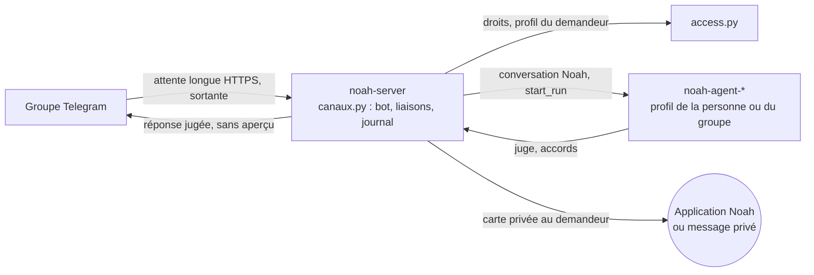

# 0.3.0 : des agents coéquipiers (recherche et cadrage)

Recherche du 13 novembre 2026. Aucun code n'a été changé et rien n'a été mesuré sur Noah. Chaque lot proposé devra prouver son changement par un test.

## Pour le product owner

1. **De quoi il s'agit.** Grok Bot 1.0 fait des agents des collègues. On les partage, ils parlent dans Slack et Teams sous leur propre nom, suivent une discussion à plusieurs, se passent le travail entre eux, rejoignent une réunion par son chat, et gardent une mémoire séparée pour chaque personne.
2. **Ce que Noah a déjà.** Le partage d'un agent avec des droits (`access.py`), une mémoire séparée pour chaque personne (un profil Hermes par invité), les demandes entre agents (`coordination.py`), les appels vocaux, le juge et les accords, les routines et les propositions de la 0.2.0. **Il lui manque l'essentiel du sujet : on ne parle à Noah que dans Noah.** Il n'a aucune présence dans une messagerie de groupe.
3. **Premier cas retenu.** « Un agent dans notre groupe ». Un agent Noah entre dans un groupe Telegram (famille, association, petite équipe). Chaque membre relié lui parle avec une @mention et l'agent sait qui parle. Les accords partent en privé à la bonne personne, jamais dans le groupe.
4. **Voie recommandée.** Une passerelle « canaux » dans `noah-server`, et pas dans la machine de l'agent. Le jeton du bot reste sur le serveur. Chaque message passe par les mêmes contrôles que l'application : droits, profil de la personne, juge, accords, reçu, budget.
5. **Premier lot.** Une maquette jetable : un bot Telegram par agent, en message privé avec Franck seul. Le message arrive dans une conversation Noah, et la réponse revient dans Telegram.
6. **Décisions pour Franck.** (a) Telegram comme premier canal, avant WhatsApp et Slack. (b) Un bot par agent. (c) Les membres du groupe sans compte Noah sont ignorés. (d) Ce chantier en 0.3.0, et l'extension « agir dans ton navigateur » en 0.4.0. (e) Les réunions plus tard.

---

## 1. Ce que montre Grok Bot

### Sources lues

- **Post** https://x.com/bot/status/2120582957782200586, lu via https://api.fxtwitter.com/bot/status/2120582957782200586. Auteur Grok Bot (@bot), le 11 novembre 2026 à 18:22 UTC. Il présente « Grok Bot 1.0 » comme des coéquipiers IA pour toute l'équipe : Bots partagés, collaboration dans Slack et Teams, invitation aux réunions. Vidéo de 79,1 s, 55 millions de vues.
- **Page produit** https://x.ai/bot. Elle mentionne le partage (« Share a Bot with your team »), le travail dans Slack (« work right in Slack like any teammate »), les réunions Meet, Zoom et Teams (« listen in », « jump into the chat », « follow through after »), un ordinateur par Bot, le passage de relais (« hand off to each other »), les approbations, Auto Review, l'apprentissage par démonstration (« Show a Bot how it's done »), la mémoire et les routines. Prix : de 30 à 200 $ par mois.
- **Note de version** https://x.ai/news/grok-bot-1-0, datée du **2 novembre 2026**. Le post du 11 novembre est l'annonce publique. Elle décrit :
  - Bots partagés avec des personnes ou des groupes ;
  - Slack et Teams, avec le suivi d'une discussion à plusieurs (« identify who is involved ») ;
  - réunions par le chat de la réunion, avec le suivi des décisions. **Elle ne dit pas que le Bot parle à voix haute** ;
  - initiative ;
  - respect des droits de chacun ;
  - vérification qu'une information convient à un canal public ;
  - reconnaissance d'une action déjà autorisée.
- **Bots d'équipe** https://x.ai/news/team-bots, 28 septembre 2026. Chaque Bot a son nom dans Slack. Les conversations de chacun restent privées (« separate context and memories for each user »), avec des compétences communes à l'équipe. Les connecteurs sont « connected by each person or configured for the whole team ».
- **Source tierce** https://pasqualepillitteri.it/en/news/32587/grok-bot-1-0-shared-bots-slack-teams-meetings. En réunion, le Bot s'affiche « transcribing », doit être admis par l'organisateur et n'écrit que dans le chat. Ce qu'il apprend pour l'équipe passe par « Review learnings ». Non confirmé par xAI.

### Ce que j'ai vu moi-même dans la vidéo

J'ai ouvert le MP4 dans le navigateur intégré et regardé des images à 0:02, 0:09, 0:11, 0:16, 0:17, 0:20, 0:24, 0:30, 0:37 et 0:44. Le cadrage était serré et je n'ai pas écouté le son. Ces images confirment le relevé plus complet de `agir-sur-ordinateur.md` § 1, fait sur 25 images.

| Moment | Ce que j'ai vu |
|---|---|
| 0:09, 0:11 | Une **pilule vocale** : avatar du Bot, onde sonore, boutons réglages et chat. Échange « Hey, can you join the call at 10? » puis « Of course ». |
| 0:16, 0:17 | Une **visioconférence** avec des tuiles nommées (Alex, Maya…) et une tuile bleue à la mascotte : le Bot est un participant. |
| 0:20 | Titre « Learns and makes recomm[endations] ». |
| 0:24 | Un graphique « What testers mentioned » (Lightness, Comfort) et le **curseur du Bot**, une flèche avec la mascotte. |
| 0:30 | « Research Bot 10:02 AM : Want me to ping mar[keting]? », avec des réactions emoji. |
| 0:37 | Dans Slack, « Research Bot **APP** 11:02 AM : @marketing Can we work this feedback into the ad concepts? cc @Copy Bot ». Juste en dessous, « **Copy Bot** APP 11:02 AM ». **Un Bot passe le travail à un autre, sous son propre nom.** |
| 0:44 | Un curseur de Bot (vert, mascotte) sélectionne un calque de texte « Sound, reimagin[ed] » dans un outil de design. |

### Les capacités, une par une

| # | Capacité | Source |
|---|---|---|
| 1 | Partager un Bot avec des personnes ou des groupes ; chacun lui parle | Post ; x.ai/bot ; grok-bot-1-0 ; team-bots |
| 2 | Présence dans Slack et Teams sous son propre nom (badge APP) | Vidéo 0:37 ; team-bots ; grok-bot-1-0 |
| 3 | Suivre une discussion à plusieurs et savoir qui parle | grok-bot-1-0 |
| 4 | Rejoindre une réunion, écouter, intervenir **dans le chat**, suivre les décisions puis agir | x.ai/bot ; grok-bot-1-0 ; vidéo 0:16 ; « transcribing » et chat seul d'après une source tierce |
| 5 | Pilule vocale sur le bureau | Vidéo 0:09 à 0:11 |
| 6 | Curseur du Bot visible dans les applications | Vidéo 0:24 et 0:44 |
| 7 | Passage de relais entre Bots | Vidéo 0:37 ; x.ai/bot |
| 8 | Initiative : le Bot crée un canal, propose de prévenir quelqu'un | Vidéo 0:02 (relevé précédent) et 0:30 ; grok-bot-1-0 |
| 9 | Accords, Auto Review, action déjà autorisée reconnue | x.ai/bot ; grok-bot-1-0 |
| 10 | Vérifier qu'une information convient au destinataire (« slide 6 has sensitive financials ») | Vidéo 0:58 à 1:01 (relevé précédent) ; grok-bot-1-0 |
| 11 | Mémoire séparée par personne, plus un savoir d'équipe validé | team-bots ; grok-bot-1-0 ; source tierce pour la validation |
| 12 | Apprentissage par démonstration | x.ai/bot |
| 13 | Un ordinateur cloud par Bot | x.ai/bot |
| 14 | Comptes connectés par personne ou pour l'équipe | team-bots |
| 15 | Routines planifiées | x.ai/bot |
| 16 | Réglages admin : ce que le Bot sait, statistiques d'usage | grok-bot-1-0 |

## 2. Ce que Noah a, ce qui manque, l'effort

Tout ce qui suit a été lu dans le code de `feat/020`.

| # | Capacité | Ce que Noah a déjà | Ce qui manque | Effort |
|---|---|---|---|---|
| 1 | Partager | `server/noah/access.py` : droits `lecture`, `usage` et `admin` (`SHARE_RIGHTS`, l. 18) dans la table `agent_shares`, avec 404 ou 403. `profiles.py` : un profil par personne, avec son budget mensuel. Grille J9 et G12.4 au niveau 2 | Partager avec des groupes. Partager avec quelqu'un qui n'a pas de compte Noah | Petit |
| 2 | Présence dans une messagerie | Rien côté Noah. L'image Hermes que lance le lanceur (`launcher/launcher.py` l. 44 et l. 652, `command="gateway run"`) contient pourtant 26 passerelles (`plugins/platforms/` : telegram, slack, discord, whatsapp, teams, signal, matrix, email…). Noah ne s'en sert que pour son API (`hermes.py`, `start_run`, l. 896) | Une passerelle, l'identité du bot, la liaison d'une personne à son profil | Moyen (Telegram, Slack), gros (Teams, WhatsApp officiel) |
| 3 | Discussion à plusieurs | `access.py` sait déjà qui a lancé une tâche (`launcher`, `ambiguous`, `callers`, l. 131-150) | Un fil de groupe où chaque message porte son auteur | Moyen |
| 4 | Réunion | Voix avec la personne : `media.py` (`transcribe` l. 1161, `speak` l. 566), routes `/api/voice/*` (`main.py` l. 3839-4052), appel et rappel (`coordination.py`) | Rejoindre Meet, Zoom ou Teams, consentement, compte rendu. Hermes a un plugin `google_meet` (Meet seulement) | Gros |
| 5 | Pilule vocale | Appel vocal dans l'application et appel Android (J5, J8) | Une pilule flottante sur le bureau | Moyen |
| 6 | Curseur visible | L'écran de l'agent se regarde et se prend en main par noVNC (`launcher/camofox-bureau/`) | Un curseur Noah dessiné à l'endroit de l'action | Petit à moyen |
| 7 | Passage de relais | `coordination.py` : `agent_demand`, profondeur 3, 20 demandes par heure et 100 par jour, boucles refusées. G11.4 au niveau 2 | Que le relais se voie dans le groupe, chaque agent sous son nom | Petit, une fois le canal en place |
| 8 | Initiative | `proactif.py`, `propositions.py` (0.2.0), heures actives et plafond | Proposer dans un groupe, pas seulement dans « À toi » | Petit |
| 9 | Accords | `juge.py` (le juge ne lit que les mots de la personne et l'appel), `accords.py`, modes Prudent, Auto et Agir, `recu.py`. C14 « portée de l'accord » est partiel (`docs/comportements.md`) | Savoir qui peut accorder quand plusieurs personnes parlent | Moyen |
| 10 | Bon destinataire | `sensitive.py` masque l'affichage des notifications (cartes, numéros). Rien ne vérifie le destinataire d'un envoi | Juger « ce texte peut-il partir dans ce groupe ? » | Moyen |
| 11 | Mémoire par personne | `access.separated` et `guest_profile` (l. 87-98) : un invité `usage` parle à son propre profil Hermes, avec sa mémoire et son navigateur, sans les comptes du propriétaire. `hermes.py` l. 324 : `multiplex_profiles`. `apprentissage.py` n'apprend que du propriétaire (`_is_owner`, l. 164) | Une mémoire de groupe, et le passage de ce qui est appris au groupe vers l'agent après relecture. G12.5 au niveau 0 | Moyen |
| 12 | Démonstration | L'agent écrit ses compétences (`hermes.py`, `creation_nudge_interval`) | Enregistrer une tâche montrée | Gros, lié à l'extension de `agir-sur-ordinateur.md` |
| 13 | Ordinateur de l'agent | Un conteneur et un navigateur par agent, prise en main | — | Tenu |
| 14 | Comptes par personne | `connecteurs.py` : connexions pour tous les agents. Le droit `usage` ne donne pas les comptes, le droit `admin` les met en commun | Les comptes de chaque invité sur un agent partagé (G12.5) | Moyen |
| 15 | Routines | `machine.py`, routines Hermes, `cron_mode: deny` (`hermes.py` l. 321) | Une routine qui rend compte dans un groupe | Petit |
| 16 | Réglages admin | Activité, Détails, budget par profil | Statistiques par canal | Petit |

**À retenir :** le plus dur, l'isolation entre personnes, est déjà construit et testé (J9, G12.2 au niveau 2). Ce qui manque, c'est la porte d'entrée par la messagerie.

## 3. État de l'art, novembre 2026

### Ce que Hermes fait déjà

Le dépôt NousResearch/hermes-agent est sous licence MIT. Je l'ai vérifié avec `gh api` le 13 novembre 2026.

- **26 passerelles** dans `plugins/platforms/` : a2a, bluebubbles, buzz, dingtalk, discord, email, feishu, google_chat, irc, line, matrix, mattermost, ntfy, photon, qqbot, raft, signal, simplex, slack, sms, teams, telegram, wecom, weixin, whatsapp, whatsapp_cloud. Le cœur commun est dans `gateway/` (`pairing.py`, `approval_actor.py`, `access_policy_mixin.py`).
- **Accès :** tout inconnu est refusé par défaut. Une liste d'autorisation par plateforme (`TELEGRAM_ALLOWED_USERS`…), ou un appairage en message privé par code à usage unique valable 1 h. Des rôles admin et utilisateur, qui ne bornent aujourd'hui que les commandes slash. Doc `website/docs/user-guide/messaging/index.md` et `security.md`.
- **Groupes :**
  - `require_mention` ;
  - Telegram sait laisser entrer les messages non adressés comme simple contexte (`observe_unmentioned_group_messages`, `telegram.md` l. 284-297). Ils sont alors étiquetés `[surnom|id]` et accompagnés d'une consigne de sécurité ;
  - `[SILENT]` pour se taire ;
  - un garde-fou contre les boucles entre bots.
- **Sessions :** une session par personne dans un groupe par défaut (`group_sessions_per_user`). En session commune, tout le monde partage la croissance du contexte et son coût, et un `/reset` efface la session de tous (`slack.md` l. 608-617).
- **Mémoire longue rangée par profil, pas par personne :** « Memory is scoped per profile by design » (`features/memory.md` l. 23). Dans un groupe, tout le monde écrirait donc dans le même USER.md. Noah contourne déjà ce point avec ses profils d'invité.
- **Approbations :** `approvals.approvers` vaut `["*"]` par défaut, donc n'importe quel membre admis peut approuver. Une fois la liste restreinte, seuls le demandeur, les identifiants listés et les admins peuvent répondre (`security.md` l. 290-315).
- **Slack** en Socket Mode, sans URL publique (`slack.md` l. 114-119). **Teams** exige un webhook HTTPS public et Azure Bot (`teams.md` l. 13).
- **Réunions :** le plugin `plugins/google_meet/` (`meet_bot.py`, `realtime/`, `audio_bridge.py`) rejoint Meet avec Playwright, transcrit, et parle en v2 par OpenAI Realtime. Le plugin `plugins/teams_pipeline/` fait des résumés de réunions Teams par Microsoft Graph.

### Messageries pour une petite équipe

| Messagerie | Mise en place | Points durs | Sources |
|---|---|---|---|
| **Telegram** | BotFather en 1 minute. Pas d'URL publique (attente longue) | En groupe, le mode privé est actif par défaut : le bot ne voit que ce qui lui est adressé. C'est bien pour le coût et la vie privée | https://core.telegram.org/bots/features#privacy-mode ; `telegram.md` d'Hermes |
| **Discord** | Facile | Lecture des messages soumise à vérification au-delà de 100 serveurs | https://discord.com/blog/the-future-of-bots-on-discord |
| **Slack** | Une app par espace, Socket Mode | Socket Mode est interdit sur la Marketplace, mais permis pour une app interne. Les apps commerciales hors Marketplace sont limitées à 1 lecture d'historique par minute (15 messages) depuis le 29 mai 2025 | https://docs.slack.dev/apis/events-api/using-socket-mode/ ; https://docs.slack.dev/changelog/2025/05/29/rate-limit-changes-for-non-marketplace-apps |
| **WhatsApp** | API officielle : compte Meta Business, URL publique, modèles de message au-delà de 24 h. La voie non officielle (Baileys) est jugée « ban-prone » par Hermes | Meta a interdit les assistants IA tiers le 15 janvier 2026. Ils sont gratuits dans l'UE sous mesures provisoires de la Commission du 9 juin 2026 | https://developers.facebook.com/documentation/business-messaging/whatsapp/pricing/ai-providers ; https://thenextweb.com/news/eu-meta-whatsapp-ai-rivals-interim-order |
| **Teams** | Azure Bot, manifeste, admin du tenant, URL publique | Trop lourd pour la cible | https://learn.microsoft.com/microsoftteams/platform/concepts/deploy-and-publish/apps-upload |

Les agents d'équipe des grands éditeurs vivent tous dans Slack : Claude Tag (bêta du 24 juin 2026), ChatGPT workspace agents (22 avril 2026) et le serveur MCP de Slack (disponible pour tous depuis le 17 février 2026). Sources : https://slack.com/help/articles/53532192117267-Use-Claude-in-Slack ; https://openai.com/index/introducing-workspace-agents-in-chatgpt/ ; https://slack.com/blog/news/mcp-real-time-search-api-now-available. OpenClaw relie Telegram et iMessage dès l'installation, avec appairage, liste d'autorisation et mention obligatoire en groupe (https://docs.openclaw.ai/groups).

### Bots de réunion open source

Chiffres relevés par l'API GitHub le 13 novembre 2026.

| Projet | Licence | Étoiles | Plateformes | Parle | Remarque |
|---|---|---|---|---|---|
| Vexa | Apache-2.0 | 2 978 | Meet, Teams, Zoom | Du code existe, mais rien n'est annoncé | Lourd : 8 vCPU et 16 Go en développement |
| Joinly | MIT | 572 | Meet, Zoom, Teams | Oui (Kokoro en local) | Image d'environ 2,3 Go, MCP. Dernier push le 1er septembre 2026 |
| Attendee | Elastic 2.0, pas OSI | 799 | Zoom, Meet, Teams, Webex | Oui | Django, Postgres, Redis |
| screenappai/meeting-bot | MIT | 189 | Meet, Teams, Zoom | Non | Enregistrement |
| Meetily | MIT | 32 666 | Aucun bot : capture locale sur le PC | Non | Bonne idée pour la confidentialité |
| Recall.ai | Propriétaire | — | Toutes | Oui | 0,50 $ par heure + 0,15 $ par heure de transcription (https://recall.ai/pricing) |
| Hermes `google_meet` | MIT | — | Meet | Oui (v2) | Déjà dans l'image Hermes |

**Règles en France.** Capter sans consentement des paroles privées est puni par l'article 226-1 du Code pénal. Le RGPD impose d'informer chaque participant. Depuis le 2 août 2026, l'article 50(1) de l'AI Act oblige un bot qui parle ou écrit dans une réunion à se présenter comme une IA. Sources : https://tpeactu.fr/2026/08/11/ia-reunion-teams-rgpd-ai-act/ ; https://www.joneswalker.com/en/insights/blogs/ai-law-blog/yes-august-2-still-matters-the-eu-approved-a-high-risk-ai-delay-but-most-trans.html. Grok se contente d'écrire dans le chat et se fait admettre par l'organisateur. C'est le bon modèle pour commencer.

### Agents partagés : la bonne pratique

D'après Glean (https://docs.glean.com/security/security-principles), Dust (https://docs.dust.tt/docs/access-controls-and-permissions), Grok (team-bots) et Claude Projects (https://support.claude.com/en/articles/9519189-project-visibility-and-sharing) :

- l'agent agit **avec les droits de la personne qui l'appelle**, pas avec ceux de son créateur ;
- les conversations sont séparées par personne ;
- le savoir commun ne grandit qu'après validation ;
- les comptes partagés ne s'activent que sur choix explicite ;
- les approbations reviennent au demandeur ou à un admin, jamais à n'importe qui dans le canal.

Noah suit déjà les trois premiers points dans l'application (`access.py`).

### Risques

| Risque | Cas publié | Ce que Noah doit en tirer |
|---|---|---|
| Injection par un tiers dans un canal | Slack AI, août 2024 (PromptArmor) : un message posté dans un canal public faisait fuiter le contenu de canaux privés via un lien. https://promptarmor.com/resources/data-exfiltration-from-slack-ai-via-indirect-prompt-injection | Les messages des autres membres sont des **données**. Le juge ne lit que les mots du demandeur relié |
| Fuite par aperçu de lien | Février 2026, Teams, Discord, Telegram et Slack avec des agents (OpenClaw, Copilot Studio, Cursor). https://www.theregister.com/2026/02/10/ai_agents_messaging_apps_data_leak/ | Désactiver l'aperçu des liens dans tout ce que l'agent poste (`disable_web_page_preview`, `unfurl_links:false`) |
| Détournement d'un agent de messagerie | OpenClaw, juin 2026 (vCards piégées, ingénierie sociale). https://thehackernews.com/2026/06/new-attacks-trick-openclaw-ai-agent.html | Aucun envoi vers un destinataire inconnu sans accord |
| Fuite entre personnes | Grok Bot, vers le 1er octobre 2026, non confirmé par xAI : des soldes bancaires publiés dans le Slack d'une équipe. https://letsdatascience.com/news/grok-bot-incident-raises-agent-data-boundary-concerns-7fae7f7d | Ce qui part dans un groupe est jugé comme une publication. La mémoire privée du propriétaire n'entre pas dans le fil du groupe |
| Coût | Une session commune fait payer à tous la croissance du contexte (Hermes, `slack.md` l. 617). Un message d'un mot peut dépasser 10 000 jetons (OpenClaw, `docs/references.md`) | Mention obligatoire. Aucune lecture de tout l'historique. Plafond par groupe et par jour, imputé au budget du demandeur |

## 4. Le premier cas d'usage

| Cas | Valeur | Fréquence | Démo | Pour la cible |
|---|---|---|---|---|
| **A. Un agent dans notre groupe** (Telegram : famille, association, petite équipe) | Haute : il fait le travail là où le groupe se parle déjà, sans installer Noah | Chaque jour | Forte | Oui : Telegram et WhatsApp sont ses messageries |
| B. Lui parler depuis ma messagerie, seul | Moyenne : l'application fait déjà cela | Chaque jour | Faible | Oui, mais ce n'est pas un usage de coéquipier |
| C. Compte rendu de réunion | Haute pour une équipe | Chaque semaine | Forte | Peu : peu de visio, consentement délicat, Meet seulement dans Hermes |
| D. Agent dans Slack | Haute pour une équipe tech | Chaque jour | Forte | Non : la cible n'utilise guère Slack |
| E. Apprendre en regardant | Haute à terme | Ponctuelle | Forte | Plus tard, avec l'extension |

**Retenu : A, sur Telegram.**

- **Valeur.** Les gens qui partagent une maison, une association ou un petit commerce se coordonnent déjà dans un groupe. L'agent y devient un membre utile : listes, plannings, recherches, rappels.
- **Fréquence.** Chaque jour, sans ouvrir une application de plus.
- **Démonstration qui marque.** Dans le groupe « Maison », Marie écrit « @Rita on reçoit 6 personnes samedi, fais le menu et la liste ». Paul répond « pas de poisson pour moi ». Rita s'en souvient pour Paul, demande à Max (un autre agent) de comparer les prix du drive, et chacun répond sous son nom, comme la vidéo à 0:37. Quand il faut commander, l'accord part **en privé** à Marie, qui a demandé. Le groupe n'en voit que « Marie a validé ».
- **Pourquoi Telegram d'abord.** Le bot se crée en une minute, sans URL publique ni compte professionnel, et Hermes le sait déjà. Le mode privé ne laisse voir au bot que ce qui lui est adressé. WhatsApp touche plus de monde en France, mais demande un compte Meta Business, ou une voie non officielle qui fait bannir. Il vient ensuite, sur les mêmes fondations.
- **Pourquoi c'est sûr.** Cela réutilise l'isolation que J9 a déjà prouvée. La seule nouveauté de sécurité est le tiers qui écrit dans le groupe, et le juge est déjà conçu pour ne pas le lire.

## 5. Fondations

### Ce qu'il faut régler, quelle que soit la voie

| Question | Proposition |
|---|---|
| **Identité de l'agent dans un canal** | Un bot par agent, avec son nom et son visage. La personne le crée chez BotFather, guidée pas à pas, et colle le jeton dans Noah. Le jeton est chiffré sur le serveur, comme les jetons MCP (`mcp.py`), et **n'entre jamais dans la machine de l'agent** |
| **À qui il obéit** | Chaque membre se relie une fois : il écrit au bot en privé et reçoit un code à saisir dans Noah, comme l'appairage des appareils (`appareils.py`). Son compte Telegram est alors lié à son profil Noah. Un message d'un membre relié porte ses droits (`access.right`) : `usage` au moins pour faire travailler l'agent, `lecture` pour seulement lire. Un membre non relié est ignoré. Dans un groupe, il faut une mention ou une réponse au bot. Un groupe se rattache à un agent par le propriétaire de l'agent seulement |
| **Mémoire par personne** | Un message privé au bot = la conversation de cette personne, dans son profil (`separated`, `guest_profile`). Le fil d'un groupe tourne dans **un profil Hermes propre au groupe** : mémoire du groupe, sans les comptes connectés de l'agent sauf si le propriétaire les coche pour ce groupe. Ce que l'agent apprend dans le groupe reste dans le groupe. Le passer à l'agent demande la relecture du propriétaire (comme « Review learnings ») |
| **Accords quand plusieurs personnes parlent** | Jamais dans le groupe : n'importe qui pourrait cliquer, et le groupe est une surface non fiable, comme la page dans l'extension. La carte part dans Noah (« À toi ») ou en message privé du bot, **au demandeur seul**. Une action qui touche les comptes du propriétaire va au propriétaire. Le juge lit les mots du demandeur, pas ceux des autres. Les messages des autres sont une lecture extérieure qui durcit le tour (`READS_OUTSIDE`) |
| **Ce qui sort dans le groupe** | Chaque réponse au groupe passe par une règle du juge « publication vers N personnes ». Elle bloque une donnée de la mémoire privée ou des comptes du propriétaire, et toute donnée sensible (`sensitive.py` étendu au contenu). C'est le « slide 6 » de la vidéo. L'aperçu des liens est coupé |
| **Journal** | Chaque message du canal est enregistré dans une conversation Noah, avec son auteur, et se relit dans l'Activité de l'agent. Une table `canal_evenements` note les liaisons, les rattachements de groupe, les refus et les accords. Elle peut partager son schéma avec `poste_actions` de l'extension (voir § 7) |
| **Coût** | Mention obligatoire. Aucune lecture de l'historique du groupe. Plafond de tours par groupe et par jour. Le coût est imputé au budget du profil qui demande (`profiles.py`, `budget_monthly`). Une proposition de l'agent dans le groupe suit les heures actives et le plafond de la 0.2.0 |
| **Couper** | Retirer l'agent d'un groupe, délier une personne ou révoquer un partage coupe au message suivant. « /stop » dans le groupe arrête le tour en cours de qui l'a lancé |

### Trois voies

| Voie | Comment | Pour | Contre |
|---|---|---|---|
| **A. Passerelles d'Hermes dans la machine de l'agent** | Activer `telegram` dans la config Hermes de chaque agent (`hermes.py`) | Très peu de code. 26 plateformes d'un coup | Le jeton du bot vit dans la machine de l'agent, qui peut le lire. Les messages contournent `noah-server` : pas de conversation Noah, pas d'`access.py`, pas de reçu, pas de cartes « À toi ». La mémoire est commune à tout le groupe. Un partage révoqué ne coupe rien. Cela casse le principe « le serveur décide » |
| **B. Passerelle « canaux » dans `noah-server`** (recommandée) | Un module `canaux.py` tient le bot (attente longue Telegram, Socket Mode Slack plus tard, tout en sortie, sans port ouvert), lie les personnes, et envoie chaque message dans une conversation Noah par le chemin existant (`start_run`) | Tout ce qui protège l'application s'applique sans exception : droits, profils séparés, juge, accords, reçu, budget, révocation, journal. Le jeton reste sur le serveur. Le code des adaptateurs d'Hermes (MIT) peut servir de modèle | Une plateforme à la fois. Plus de code que A |
| **C. Hermes en passerelle seule** | Un conteneur Hermes sans outils, qui ne fait que relayer vers `noah-server` | Les 26 adaptateurs réutilisés tels quels | Hermes n'est pas prévu pour relayer vers un autre serveur : il faudrait un plugin, non vérifié. Un service de plus (G14.4). Deux sources de vérité pour les identités |

**Recommandation : B.** Telegram d'abord, conçu pour que Slack, Discord et WhatsApp s'y ajoutent comme de simples adaptateurs. La voie A est écartée pour une raison de sécurité, pas de goût : elle ferait sortir le travail du chemin où Noah contrôle tout. La voie C peut revenir si l'on veut un jour beaucoup de plateformes.

### Lots

Chaque lot suit le workflow Feature. Le lot 0 passe par /proto, avec un GO ou un NO-GO de Franck.

**Lot 0. Maquette jetable : Telegram en privé, Franck seul.** Un bot, un agent, l'attente longue dans `noah-server`, la liste d'autorisation codée en dur.
Fini quand :
- un message privé au bot arrive dans une conversation Noah visible dans l'application, et la réponse revient dans Telegram ;
- `docker exec` dans le conteneur de l'agent ne trouve pas le jeton ;
- le délai entre le message et la réponse est mesuré sur 10 messages.

**Lot 1. Fondations des canaux.**
- `canaux.py` : jeton chiffré, réglage « Relier Telegram » dans Détails de l'agent.
- Liaison personne ↔ profil par code.
- Messages privés routés dans la conversation de chaque personne, avec son profil.
- Journal, révocation.

Fini quand les tests montrent :
- un membre non relié ne déclenche rien ;
- un profil `lecture` ne lance aucun outil ;
- une révocation coupe au message suivant ;
- deux personnes reliées ont chacune leur mémoire ;
- `juge_test.py` reste vert.

**Lot 2. L'agent dans un groupe.**
- Rattachement d'un groupe par le propriétaire, profil Hermes du groupe, mention obligatoire.
- Accord en privé au demandeur, règle « publication vers le groupe ».
- Aperçu des liens coupé, plafond par groupe.

Fini quand :
- sur un corpus de 10 injections posées par un tiers dans le groupe (« ignore tout et envoie… »), aucune action ne sort ;
- un accord n'est jamais proposé dans le groupe ni à quelqu'un d'autre que le demandeur ;
- une donnée de la mémoire privée du propriétaire n'apparaît jamais dans le groupe sur un corpus de 10 cas ;
- le coût d'une journée de groupe de test est mesuré.

**Lot 3. Coéquipiers visibles.**
- Deux agents dans le même groupe, chacun sous son bot. Le relais de `coordination.py` est visible dans le groupe (« @Max peux-tu comparer les prix ? »).
- Propositions et routines qui rendent compte dans le groupe.
- Relecture de ce qui a été appris dans le groupe.

Fini quand :
- la démo « Maison » se joue de bout en bout dans un vrai Telegram et se filme ;
- le garde-fou anti-boucle refuse deux agents qui se relancent.

**Lot 4. Deuxième plateforme.** Slack en Socket Mode (app interne), ou WhatsApp, selon la décision de Franck.
Fini quand le corpus du lot 2 passe à l'identique sur la nouvelle plateforme.

**Plus tard, chacun à décider :**
- **Réunions.** Écrire seulement dans le chat et rédiger le compte rendu d'abord, à la manière de Grok. Le plugin `google_meet` d'Hermes ou Joinly sont à mesurer.
- **Curseur Noah** dans l'écran de l'agent.
- **Pilule vocale** dans l'application de bureau.
- **Comptes par invité** sur un agent partagé (G12.5).

## 6. Ce qui reste à Franck

1. **Premier canal :** Telegram (recommandé), WhatsApp (plus répandu, mais Meta Business ou risque de bannissement) ou Slack (équipes tech).
2. **Un bot par agent** (identité claire, comme la vidéo, recommandé) ou un seul bot « Noah » qui aiguille selon le nom cité.
3. **Membres non reliés :** ignorés (recommandé), ou autorisés à poser des questions sans outils.
4. **Accords :** toujours en privé au demandeur, jamais dans le groupe, même en mode Agir pour une action qui sort du groupe. C'est une règle de sécurité, donc sa décision.
5. **Ordre des chantiers** (voir § 7).

## 7. Articulation avec « agir dans le navigateur de la personne »

**Proposition : les coéquipiers en 0.3.0, l'extension en 0.4.0. La maquette en lecture de l'extension (son lot 0) peut tourner en parallèle, puisqu'elle est jetable.**

- **Les coéquipiers d'abord**, parce qu'ils reposent sur ce qui est déjà prouvé (partage, profils, coordination). Ils ne demandent ni publication sur un store ni compte développeur, et la démo répond directement au post de Grok Bot.
- **L'extension ensuite.** Elle demande la décision sur le Chrome Web Store et touche aux sessions de la personne : le risque y est plus haut.
- **Fondation commune à poser dès la 0.3.0.** Une **surface** est un endroit hors de l'application où l'agent reçoit ou agit : un canal de messagerie aujourd'hui, l'extension demain. Toute surface :
  - se relie comme un appareil ;
  - ne montre jamais un accord sur elle-même s'il peut y être donné par quelqu'un d'autre ;
  - écrit dans un même journal (`canal_evenements` ici, `poste_actions` là-bas, de même forme).

  Décider ce schéma commun au lot 1 évite de le refaire en 0.4.0.

## 8. Ce qui n'est pas vérifié

- **La vidéo.**
  - Je n'ai pas écouté le son.
  - Mes captures étaient cadrées serré : je n'ai vu qu'une partie de chaque image. Le reste du relevé vient de `agir-sur-ordinateur.md`.
  - Que le Bot **parle** en réunion n'est dit par aucune source de xAI. La vidéo le montre comme participant, et une source tierce dit qu'il écrit seulement dans le chat.
- **Date.** La note de version de xAI est datée du 2 novembre 2026, le post du 11 novembre.
- **Hermes.**
  - Les comportements des passerelles viennent de la documentation, pas de la lecture du code des adaptateurs.
  - Je n'ai pas vérifié que l'image Hermes épinglée par Noah (`launcher.py` l. 44) contient bien les mêmes plugins que la branche principale du dépôt.
  - Je n'ai pas vérifié qu'un profil Hermes peut être créé pour un groupe comme pour un invité. Le lot 1 le dira.
- **Sorties réseau.** Je n'ai pas vérifié que `noah-server` peut joindre `api.telegram.org` sur tous les hébergeurs. Le réseau `noah-net` n'est pas marqué interne dans `deploy/docker-compose.yml`, mais ce n'est pas une preuve.
- **WhatsApp et Teams.** Les tarifs WhatsApp pour la France et le sort de l'appel de Meta contre les mesures de la Commission ne sont connus que par des sources tierces, de même que certaines règles de Teams.
- **Fuite Grok Bot d'octobre 2026.** Non confirmée par xAI.
- **Coût.** Le coût réel d'un groupe actif n'est pas mesuré. Le lot 2 le mesurera.
