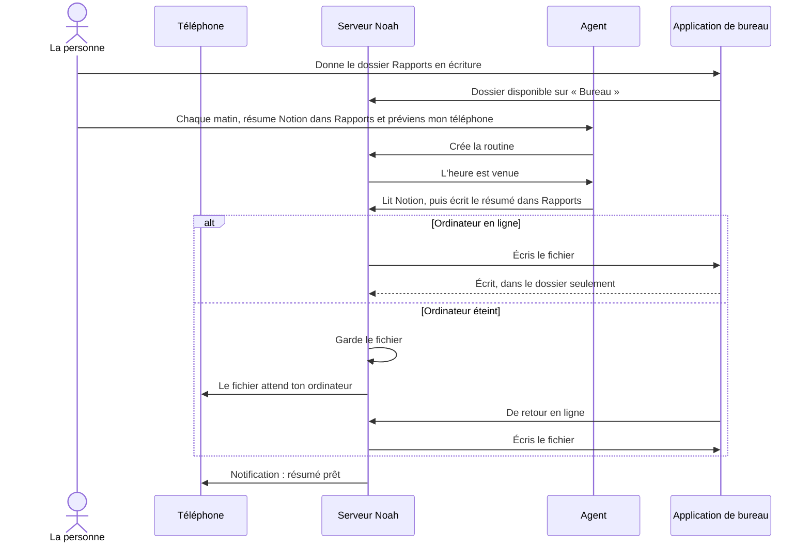
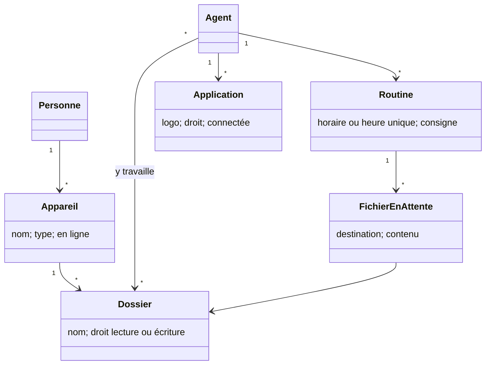

# Un agent sur le VPS qui agit sur mes appareils

## L'histoire

En tant que personne qui héberge Noah sur son VPS, je veux que mon agent, dont le cerveau tourne 24 h/24 sur le serveur, travaille dans les dossiers de mon ordinateur et choisisse l'appareil où agir, et que je relie mes applications en un clic, afin d'avoir le niveau de Claude Dispatch, Grok ou Dots en ne confiant mes données qu'à mon serveur et au modèle que je choisis.

## Le contexte

L'agent tourne sur le VPS, mais donner un dossier ne marche que si Noah tourne sur l'ordinateur lui-même. Il ne sait pas quels appareils sont en ligne : une notification part partout. Une application MCP demande de copier une adresse à la main, et l'agent propose un lien de Nous Portal, un service tiers, sans voir ce qui est déjà connecté. Il s'arrête sur un écran de cookies. Il n'a aucune consigne pour une tâche unique (« dans 5 minutes »). Les applications s'affichent avec une lettre au lieu de leur logo.

## Critères d'acceptation

### A. Connexions

- Étant donné Notion dans Connexions sur le web, quand je clique « Connecter » et que j'accepte, alors je reviens sur Noah, à l'adresse de mon serveur, avec « Notion est connecté », sans adresse à copier.
- Étant donné la même chose depuis l'application de bureau, alors le navigateur propose de rouvrir l'application, qui affiche « Connecté ».
- Étant donné un fournisseur qui refuse cette adresse de retour, alors la voie par copier-coller reste proposée.
- Étant donné Notion connecté, quand je demande « vois-tu mon Notion ? », alors l'agent répond oui et s'en sert, en moins d'une minute.
- Quel que soit le message, l'agent ne propose plus de lien Nous Portal, et aucun compte anonyme n'est créé chez ce tiers. L'écran d'accord dit « Noah Agent ».
- Chaque application affiche son vrai logo, récupéré par mon serveur, sans que mon navigateur appelle un tiers. Sans logo disponible, la lettre reste.

### B. Agent qui va au bout

- Étant donné « ouvre ma chaîne YouTube », quand un écran de cookies apparaît, alors l'agent l'accepte et montre la chaîne, sans rien me demander.
- L'agent ne s'arrête que pour un mot de passe, un code, un CAPTCHA, un paiement, ou un envoi et une suppression que je n'ai pas demandés.

### C. Tâche programmée

- Étant donné « dans 5 minutes, fais X », alors l'agent crée la tâche et donne son heure. À cette heure, X est fait, le résultat arrive dans la conversation, et une notification part, à l'écrit, à la voix, sur le web et sur mobile.
- Un test réel passe sur le VPS avec un vrai modèle, en vrai délai.

### D. Dossiers de mon ordinateur, agent sur le VPS

- Dans l'application de bureau, je choisis un dossier avec le sélecteur du système, en lecture ou en écriture, et je le retire quand je veux.
- L'agent liste, lit et écrit dans ce dossier sans me demander, selon le droit donné. Il ne peut rien atteindre en dehors, même par un lien symbolique ou `..`.
- Une commande demande mon accord dans une fenêtre du système, avec « toujours autoriser cette commande dans ce dossier ». Une page ou un document lu par l'agent ne peut pas donner cet accord.
- Si mon ordinateur est éteint, un résultat de routine attend sur le VPS et arrive dans le dossier à la reconnexion. Je suis prévenu sur le téléphone que le fichier attend.
- Les droits sont gardés et appliqués par l'application de bureau, pas par le serveur : un VPS compromis ne peut pas élargir un dossier. Un bouton « Couper l'accès » dans l'application arrête tout, y compris ce qui est en attente.
- Un dossier est donné en lecture seule par défaut. Une écriture ne remplace jamais un fichier existant sans mon accord : elle crée une copie à côté. Elle est écrite d'un coup, sans fichier à moitié écrit, et « livré » n'est dit qu'après confirmation de mon ordinateur.
- « Toujours autoriser » vaut pour une commande exacte (programme et arguments). Il n'est pas proposé pour un interpréteur ou un script modifiable (PowerShell, Python, Node, fichier `.bat`) : ceux-là demandent mon accord à chaque fois. Le dossier courant d'une commande n'est pas une barrière, et la fenêtre d'accord le dit.
- En donnant un dossier, je suis prévenu que ce que l'agent lit passe par le modèle que j'ai choisi. Des fichiers sensibles (`.env`, clés, portefeuilles) sont refusés d'office.
- Un fichier fait au plus 50 Mo en v1, la file d'attente est limitée en taille et expire après 7 jours, et un dépassement est dit clairement.

### E. Choix de l'appareil

- Je vois dans Réglages > Appareils ceux qui sont en ligne. L'agent les voit aussi, par leur nom.
- « Envoie-moi ça sur mon téléphone » ne notifie que le téléphone. « Fais-le sur mon ordinateur » n'agit que là. Sans précision, la notification part partout, comme aujourd'hui.
- Une routine peut utiliser un MCP et enregistrer son résultat dans un dossier de mon ordinateur.
- Avec plusieurs ordinateurs, « mon ordinateur » ambigu fait demander lequel à l'agent. Une routine garde sa destination exacte, même si l'appareil est renommé. Un profil partagé n'atteint jamais les appareils du propriétaire.

### F. Petites choses

- L'onglet d'autorisation d'un appareil se ferme seul quand le navigateur le permet. Sinon, il dit clairement qu'on peut le fermer, sans jamais afficher de JSON.
- Après une mise à jour, le chat revient dès la fin, et le blocage dure environ 4 minutes au lieu de 12.
- Le numéro affiché reste 0.1.1 : une correction n'annonce pas de nouvelle version.

### G. Défauts déjà présents, trouvés par la relecture

- Un chemin avec `..` envoyé par l'agent dans « ouvrir » ne sort plus du dossier : l'application de bureau résout le chemin réel, refuse ce qui sort, et l'affiche dans la fenêtre d'accord.
- Lancer une application ne peut plus exécuter le reste d'un nom piégé : le nom n'entre plus dans le script PowerShell.
- La fenêtre d'accord montre tout ce que je valide : un texte à copier trop long est refusé au lieu d'être coupé à l'écran.
- Une fenêtre d'accord expirée ne peut plus lancer l'action par un clic tardif, et une action longue ne fait plus croire que l'application est fermée.
- « Ouvrir » suit une liste de types autorisés, au lieu d'une liste de types interdits, et une seule demande d'accord s'affiche à la fois.

## Hors-périmètre

- La copie synchronisée du dossier sur le VPS : refusée, l'accès se fait à la demande.
- L'accès aux fichiers depuis le téléphone : l'application mobile reçoit des notifications, elle n'exécute rien.
- Un bac à sable pour les commandes sur l'ordinateur, et le transfert des fichiers de plus de 50 Mo avec reprise : plus tard.
- Une image d'agent construite par nous à partir d'Hermes : ticket à part, voir les questions.

## Diagramme de séquence

## Diagramme de classes

## Questions ouvertes

1. **Avertissement de Windows sans payer.** Deux voies gratuites. Le Microsoft Store signe l'application à notre place, mais la gratuité du compte individuel reste à confirmer et c'est toi qui crées le compte. SignPath Foundation est gratuit, mais exige une licence open source reconnue par l'OSI : PolyForm ne l'est pas. Cette même licence ouvrirait aussi le programme Hostinger.
2. **Image d'agent à nous.** Je recommande de construire notre image à partir d'Hermes figé (licence MIT), pour retirer ce qu'on refuse au lieu de le contourner. Ticket à part, après ce lot.
